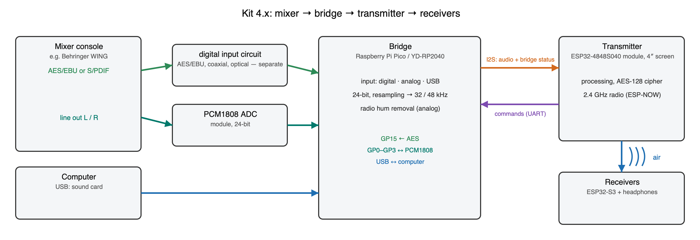
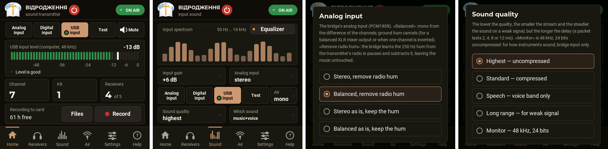
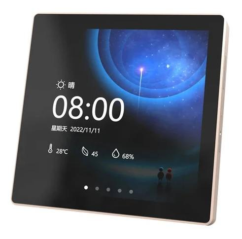
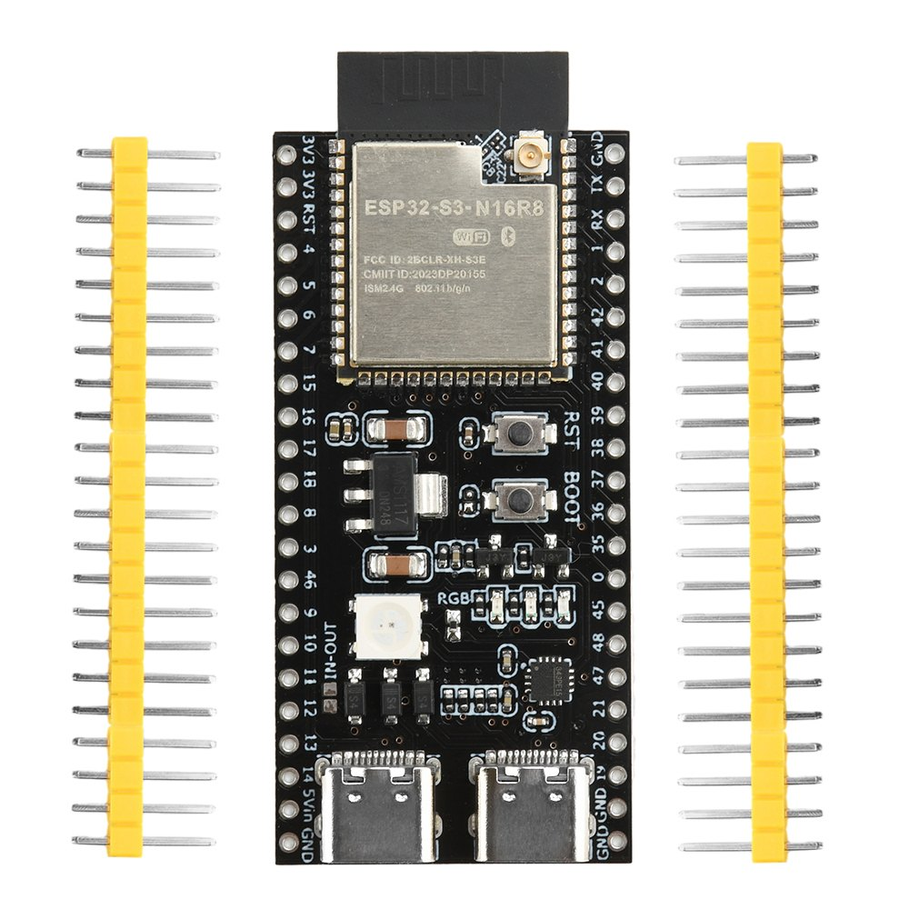
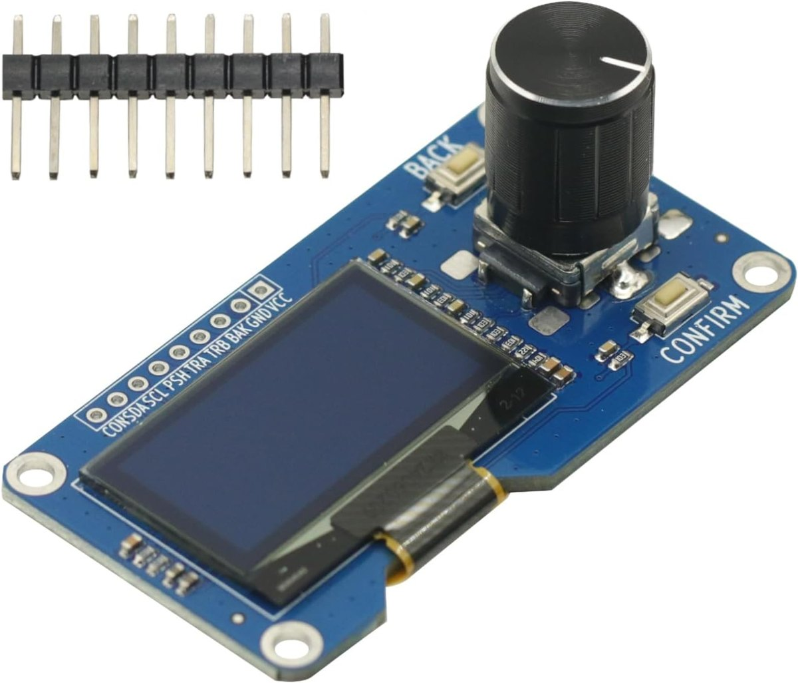
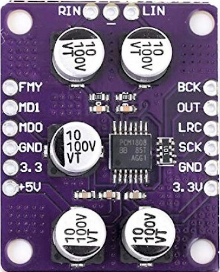

# HearLink — a digital wireless listening kit for hard-of-hearing people

**English** · [Українська](README.uk.md)

> **4.00 “Next Edition”** — a kit with a **bridge** (Raspberry Pi Pico) between the mixer and the transmitter: a
> **digital input** AES/EBU or S/PDIF (coaxial, optical) straight from the mixer, an **analog** one through a PCM1808 ADC,
> and **USB** from a computer; a 24-bit path, a “Monitor” quality of 48 kHz / 24-bit; the bridge removes the radio hum
> on the analog input by itself. **What to buy, how to build, schematics and upgrading from 3.x —
> [Kit 4.x](docs/en/next-edition.md).** The first modification (transmitter without a bridge) —
> [v3.29](../../releases/tag/v3.29) and the [`first-edition`](../../tree/first-edition) branch.

A transmitter takes the sound from a mixing desk and broadcasts it over encrypted digital radio to receivers with
headphones. A hard-of-hearing person can sit anywhere in the hall, set their own volume and hear the sermon or the
choir right in their ears — no room echo, no wires, no induction loop in the floor.

The kit was built for the «Відродження» (“Revival”) church. Everything is made of off-the-shelf modules, with no
fine-pitch soldering. One firmware runs on every board: whether a board is a transmitter or a receiver is stored
in the board itself.






<p>
 
 
 

</p>

## Features

**Bridge** (Raspberry Pi Pico / YD-RP2040, 4.x)
- three inputs: digital AES/EBU or S/PDIF (44.1 / 48 kHz, 24-bit), analog through a PCM1808 (24-bit), USB — a computer
  sees the bridge as a sound card and can record what goes on air;
- resampling to the transmitter's clock (32 or 48 kHz) in ~1.5 ms; removes the transmitter's radio hum on the analog
  input by itself (−81 → −108 dB);
- updated by the transmitter over the command wire, no computer needed.

**Transmitter** (ESP32-4848S040 module with a 4″ touch screen)
- input buttons on Home: **Analog · Digital · USB · Test · Silence**;
- five quality levels — from “highest” (uncompressed, 12–15 ms latency) to “far” (the most interference-proof), and
  **“Monitor”** — 48 kHz, 24-bit uncompressed, for listening to how instruments sound;
- mono or stereo on air;
- finds a free Wi-Fi channel by itself and leaves a channel that gets congested — receivers follow without a gap;
- receiver list: who is online, signal, loss, volume; each receiver can be named, muted, switched off,
  asked to “identify itself”, and have its speech clarity, balance and volume limit set remotely;
- over-the-air firmware update of receivers; the transmitter itself updates from a file on the memory card;
- recording the broadcast to the card (WAV), playing MP3/WAV files from the card on air, a file manager;
- test sounds (tone, voice, music, music with announcements), input level meter and spectrum;
- on-screen help, Ukrainian and English UI.

**Receiver** (ESP32-S3 board + SH1106 display with a rotary knob)
- headphones directly on the board pins or through an amplifier;
- a single knob: turn — volume, press — mute, long press — menu;
- three main-screen views: spectrum, needle meters, large volume number;
- speech clarity (treble boost +4/+8/+12 dB), left/right balance, volume limit, headphone test;
- a “Link” screen with a one-minute signal graph;
- falls asleep when the transmitter is silent and wakes up by itself; while asleep the screen, audio and radio are off — it listens to the air twice a second;
- RGB status LED, smooth animations, notifications;
- optionally a colour IPS 1.9″ display (ST7789, 320×170) instead of the OLED: every screen in colour, an analyser with
  peak marks, 60 frames per second; selected by a "pin 21 → GND" jumper (since 3.03).

**Security.** Everything on air is encrypted and signed (hardware AES-128). A foreign receiver cannot hear the
sound and a foreign transmitter cannot inject its own. A receiver is added from the transmitter screen by
comparing a four-digit code.

## What it can be used for

- churches, assembly halls, lecture rooms — assistive listening (the main purpose);
- simultaneous interpretation: the interpreter speaks into a desk microphone, listeners use headphones;
- guided tours and “silent” events where loudspeakers are unwanted;
- wireless monitoring for a sound engineer or a choir;
- quiet TV listening at home;
- recording a service to the memory card and playing background music from it.

> This is not a medical device and not a hearing aid. Headphone volume can be high — use the “Volume limit”.

## Documentation

| | |
|---|---|
| [**Kit 4.x: bridge, inputs, schematics, upgrading**](docs/en/next-edition.md) | what to buy, the PCM1808 modification, the transmitter back side (H1), bridge wiring, 5 digital input variants (AES, coaxial, optical), upgrading from 3.x |
| [Hardware and wiring](docs/en/hardware.md) | what to buy, how to connect, power and antenna requirements |
| [Installation](docs/en/install.md) | flashing ready-made files (macOS, Windows, Linux), building from source |
| [User guide](docs/en/user-guide.md) | transmitter, receiver, pairing, updates, memory card |
| [Serial commands and debugging](docs/en/commands.md) | every command, measurement tools, hands-free testing |
| [How it works](docs/en/technical.md) | radio, audio, encryption, OTA, flash layout, pitfalls |
| [Development and debugging](docs/en/development.md) | building, mandatory checks, screen simulators, crash dumps, how to add features |
| [Troubleshooting](docs/en/troubleshooting.md) | what to do when something is wrong |
| [Changelog](CHANGELOG.md) | version history |

## Quick start

1. Download `hearlink-4.00-flash-kit.zip` (firmware, the bridge program, writing programs and scripts) and the PDF
   documentation from the [latest release](../../releases/latest).
2. Build the bridge and the wiring — [Kit 4.x](docs/en/next-edition.md).
3. Flash the receivers, the transmitter and the bridge — [Installation](docs/en/install.md).
4. On the transmitter: “Приймачі / Receivers” → “+ Add”, compare the code on both screens, “Allow”.
5. Already have a 3.x kit — [Upgrading from 3.x to 4.00](docs/en/next-edition.md#upgrading-from-3x-to-400): the
   transmitter once by cable, the bridge from `bridge-full.uf2`, the receivers are updated by the transmitter over radio.

## Updating from a memory card: where to put the file and how to name it

```
microSD card (FAT32)
└── UPDATE/                  ← a folder in the card root, upper-case name
    └── hearlink-4.00.bin    ← the firmware file from a release
```

- **Folder** — `UPDATE` in the root of the card. The transmitter creates it by itself as soon as it sees a card;
  you can also create it on a computer.
- **File** — `hearlink-<version>.bin` from the [releases](../../releases/latest) page (in the flashing kit it is in
  `на карту/UPDATE/`). The same file is used for the receivers and for the transmitter.
- **The file name can be anything**; only the `.bin` extension is required (upper or lower case). The transmitter
  reads the version from inside the file, not from its name. Files whose names start with a dot are skipped.
- If the folder holds several files, the one with the newest version is taken. It is better to delete old files.
- `bootloader.bin`, `partitions.bin`, `boot_app0.bin` and `assets.bin` from the flashing kit **do not belong here** —
  they are parts for cable flashing; the transmitter will report that the file is not suitable.
- The card must be FAT32. Insert it into the transmitter: it finds the file and opens the «Оновлення» (Update)
  window → **«Оновити» (Update)**.

Details: [User guide → Firmware update](docs/en/user-guide.md#firmware-update).

## Project status

The working version is **4.00** (bridge 1.02). In use at the church on the owner's kit: transmitter, bridge, two
receivers; the AES digital input from a Behringer WING mixer (the no-transformer variant) and the analog one through a
PCM1808. The other digital input variants (transformer, 74HC04, coaxial, optical) are built from schematics but not yet
tested on hardware. The acoustic microphone-to-ear latency has not been measured yet — see
[How it works](docs/en/technical.md#not-verified).

Source comments are in Ukrainian and Russian; on-screen texts are in Ukrainian and English.

## License

The whole product — firmware, tools, schematics, documentation and media — is our own work and is distributed
freely under the [MIT License](LICENSE): use it, change it, build it, sell devices based on it; just keep the
copyright notice. All media content (test music, voice announcements, illustrations) was generated with AI and is
covered by the same license. The only exception is the module photos in `docs/photos/`: they belong to the
modules' manufacturers and sellers.

## Third-party components

Roboto (Apache 2.0) and Montserrat (SIL OFL 1.1) fonts as bitmap tables; the U8g2 library (BSD-2); the
Arduino-ESP32 core / ESP-IDF (Apache 2.0, LGPL) including the Helix MP3 decoder; esptool (GPL-2.0) in the flashing
kit. Bridge: Raspberry Pi Pico SDK and TinyUSB (BSD-3, MIT), the pico_spdif_rx library (BSD-2); picotool (BSD-3) and
libusb (LGPL-2.1) in the flashing kit. Details: [NOTICE.md](NOTICE.md).
