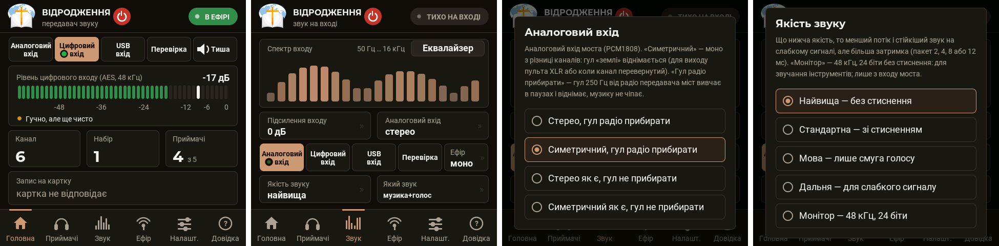

# HearLink — цифровий бездротовий набір для людей зі слабким слухом

[English](README.md) · **Українська**

> **4.00 «Next Edition»** — набір із **мостом** (Raspberry Pi Pico) між пультом і передавачем: **цифровий вхід**
> AES/EBU або S/PDIF (коаксіал, оптика) прямо з пульта, **аналоговий** через АЦП PCM1808, **USB** із комп'ютера; тракт
> 24 біти, якість «Монітор» 48 кГц / 24 біти; гул радіо на аналоговому вході міст прибирає сам.
> **Що докупити, як зібрати, схеми й перехід із 3.x — [Набір 4.x](docs/uk/next-edition.md).**
> Перша модифікація (передавач без моста) — [v3.29](../../releases/tag/v3.29) і гілка [`first-edition`](../../tree/first-edition).

Передавач бере звук із пульта (мікшера) і шифрованим цифровим радіо роздає його приймачам із навушниками.
Людина зі слабким слухом сидить де завгодно в залі, сама крутить гучність і чує проповідь чи спів прямо у вухах —
без луни залу, без дротів і без індукційної петлі в підлозі.

Набір зроблено для церкви «Відродження»; усе зібрано з готових модулів, які продаються в Україні, без паяння
дрібних деталей. Прошивка одна на всі плати: чи це передавач, чи приймач — записано в самій платі.





<p>
 
 
 
 

</p>

## Що вміє

**Міст** (Raspberry Pi Pico / YD-RP2040, 4.x)
- три входи: цифровий AES/EBU або S/PDIF (44,1 / 48 кГц, 24 біти), аналоговий через PCM1808 (24 біти), USB — комп'ютер
  бачить міст як звукову карту й може записувати те, що йде в ефір;
- перерахунок частоти в такт передавача (32 або 48 кГц) за ~1,5 мс; гул радіо передавача на аналоговому вході —
  прибирає сам (−81 → −108 дБ);
- оновлюється від передавача по проводу команд, без комп'ютера.

**Передавач** (модуль ESP32-4848S040 із сенсорним екраном 4″)
- кнопки входів на головній: **Аналоговий · Цифровий · USB · Перевірка · Тиша**;
- п'ять якостей — від «найвища» (без стиснення, затримка 12–15 мс) до «дальня» (найстійкіша до завад) і **«Монітор»**
  — 48 кГц, 24 біти без стиснення, для прослуховування звучання інструментів;
- моно або стерео в ефір;
- сам шукає вільний канал Wi-Fi і сам іде з каналу, де почався затор, — приймачі переходять разом із ним без паузи;
- список приймачів: хто на зв'язку, сигнал, втрати, гучність; кожному можна дати ім'я, змінити гучність,
  вимкнути, «показати себе», налаштувати чіткість мови, баланс, межу гучності;
- оновлення прошивки приймачів по радіо, а самого передавача — файлом із картки пам'яті;
- запис ефіру на картку (WAV), програвання файлів MP3/WAV із картки в ефір, файловий менеджер;
- перевірочний звук (тон, голос, музика, музика з оголошенням), рівень і спектр входу;
- довідка на екрані, українська та англійська мови.

**Приймач** (плата ESP32-S3 + екран SH1106 з ручкою)
- навушники напряму до плати або через підсилювач;
- одна ручка: поворот — гучність, натискання — тиша, довге натискання — меню;
- три вигляди головного екрана: спектр, стрілкові індикатори, велика цифра гучності;
- чіткість мови (підйом верхніх частот +4/+8/+12 дБ), баланс ліве/праве, межа гучності, перевірка навушників;
- екран «Зв'язок» із графіком сигналу за хвилину;
- сам засинає, коли передавач мовчить, і сам прокидається; у сні вимкнені екран, звук і радіо — раз на пів секунди він слухає ефір;
- кольоровий світлодіод стану, плавні анімації, сповіщення;
- за бажанням — кольоровий екран IPS 1,9″ (ST7789, 320×170) замість OLED: усі екрани в кольорі, аналізатор із
  позначками піків, 60 кадрів за секунду; вибір — перемичкою «вивід 21 → GND» (з 3.03).

**Захист.** Увесь ефір зашифровано й підписано (апаратний AES-128). Чужий приймач не почує звук, чужий передавач
не підсуне свій. Приймач додають до набору з екрана передавача, звіряючи код із чотирьох цифр.

## Для чого це можна використати

- церква, зал зібрань, лекторій — допомога людям зі слабким слухом (основне призначення);
- синхронний переклад: перекладач говорить у мікрофон пульта, слухачі — в навушниках;
- екскурсії та «тихі» заходи, де гучномовці заважають;
- бездротовий моніторинг для звукооператора чи хору;
- тихий перегляд телевізора вдома;
- запис служби на картку пам'яті та відтворення фонової музики з картки.

> Це не медичний виріб і не слуховий апарат. Гучність у навушниках може бути великою — користуйтеся «Межею
> гучності».

## Документація

| | |
|---|---|
| [**Набір 4.x: міст, входи, схеми, перехід**](docs/uk/next-edition.md) | що докупити, переробка PCM1808, зворотний бік передавача (H1), підключення моста, 5 варіантів цифрового входу (AES, коаксіал, оптика), перехід із 3.x |
| [Обладнання та схеми](docs/uk/hardware.md) | що купити, як з'єднати, вимоги до живлення й антени |
| [Встановлення](docs/uk/install.md) | прошивання готовими файлами (macOS, Windows, Linux), збирання з вихідних текстів |
| [Користування](docs/uk/user-guide.md) | передавач, приймач, додавання приймачів, оновлення, картка пам'яті |
| [Команди порту та налагодження](docs/uk/commands.md) | усі команди, інструменти вимірювань, перевірка без рук |
| [Як це влаштовано](docs/uk/technical.md) | радіо, звук, шифрування, оновлення по радіо, розмітка пам'яті, граблі |
| [Розробка та налагодження](docs/uk/development.md) | збирання, перевірки, імітатори екранів, знімок збою, як додавати функції |
| [Несправності](docs/uk/troubleshooting.md) | що робити, коли щось не так |
| [Історія версій](CHANGELOG.md) | що змінювалося |

## Швидкий початок

1. Візьміть із [останнього випуску](../../releases/latest) архів `hearlink-4.00-flash-kit.zip` (прошивки, програма
   моста, програми запису й сценарії) і PDF з описом.
2. Зберіть міст і підключення — [Набір 4.x](docs/uk/next-edition.md).
3. Прошийте приймачі, передавач і міст — [Встановлення](docs/uk/install.md).
4. На передавачі: «Приймачі» → «+ Додати», звірте код на двох екранах, «Дозволити».
5. Уже є набір 3.x — [Перехід із 3.x на 4.00](docs/uk/next-edition.md#перехід-із-3x-на-400): передавач один раз кабелем,
   міст — файлом `bridge-full.uf2`, приймачі передавач оновить по радіо сам.

## Оновлення через картку пам'яті: куди й під яким ім'ям класти файл

```
картка microSD (FAT32)
└── UPDATE/                  ← тека в корені картки, ім'я великими літерами
    └── hearlink-4.00.bin    ← файл прошивки з випуску
```

- **Тека** — `UPDATE` у корені картки. Передавач створює її сам, щойно побачить картку; можна створити й на
  комп'ютері.
- **Файл** — `hearlink-<версія>.bin` зі сторінки [випусків](../../releases/latest) (у наборі для прошивання він
  лежить у `на карту/UPDATE/`). Це той самий файл і для приймачів, і для передавача.
- **Ім'я файла може бути будь-яким**, обов'язкове лише розширення `.bin` (великими чи малими). Версію передавач
  читає зсередини файла, а не з імені. Файли, що починаються з крапки, пропускаються.
- Якщо в теці кілька файлів, береться той, у якого версія найновіша. Старі файли краще видаляти.
- **Не годяться** сюди `bootloader.bin`, `partitions.bin`, `boot_app0.bin`, `assets.bin` з набору для прошивання —
  це частини для заливання кабелем; передавач покаже «файл не годиться».
- Картка — FAT32. Вставити її в передавач: він сам знайде файл і відкриє вікно «Оновлення» → **Оновити**.

Докладно — [Користування → Оновлення прошивки](docs/uk/user-guide.md#оновлення-прошивки).

## Стан проєкту

Робоча версія — **4.00** (міст 1.02). Працює в церкві на наборі власника: передавач, міст, два приймачі; цифровий вхід
AES із пульта Behringer WING (варіант без трансформатора) і аналоговий через PCM1808. Інші варіанти цифрового входу
(трансформатор, 74HC04, коаксіал, оптика) зібрано за схемами, але на приладі ще не перевірено. Затримку «від мікрофона
до вуха» акустично ще не виміряно — див. [Як це влаштовано](docs/uk/technical.md#що-не-перевірено).

Коментарі у вихідних текстах — українською й російською, написи на екранах — українською та англійською.

## Ліцензія

Увесь продукт — прошивка, інструменти, схеми, документація та медіа — наша власна розробка й поширюється вільно
за [ліцензією MIT](LICENSE): користуйтеся, змінюйте, збирайте, продавайте пристрої на його основі — лише зберігайте
зазначення авторських прав. Увесь медіаконтент (перевірочна музика, голосові оголошення, ілюстрації) згенеровано
ШІ й поширюється за тією самою ліцензією. Виняток — фотографії модулів у `docs/photos/`: вони належать
виробникам і продавцям модулів.

## Чуже в проєкті

Шрифти Roboto (Apache 2.0) і Montserrat (SIL OFL 1.1) — у вигляді растрових таблиць; бібліотека U8g2 (BSD-2);
ядро Arduino-ESP32 / ESP-IDF (Apache 2.0, LGPL), декодер MP3 Helix із ядра; esptool (GPL-2.0) — у наборі для
прошивання. Міст: Raspberry Pi Pico SDK і TinyUSB (BSD-3, MIT), бібліотека pico_spdif_rx (BSD-2); picotool (BSD-3) і
libusb (LGPL-2.1) — у наборі для прошивання. Докладніше — [NOTICE.md](NOTICE.md).
