# Hardware and schematics

[← back to main page](../../README.md) · [Українська](../uk/hardware.md)

> **Kit 4.x.** The inputs (digital AES/S/PDIF, analog PCM1808, USB) are now on the **bridge** — a Raspberry Pi Pico
> board between the mixer and the transmitter. What to buy, how to modify the PCM1808 module, wiring schematics, the
> transmitter back side with connector H1 and the digital input variants — **[Kit 4.x: bridge, inputs,
> schematics](next-edition.md)**. Below — the modules, receivers, headphones and DACs (unchanged in 4.x) and the
> PCM1808 wired straight to the transmitter (3.x only).

## What you need

### Transmitter (1 pc.)

| Part | What exactly | Notes |
|---|---|---|
| Module | **ESP32-4848S040** (also known as ESP32-4848S040C_I): ESP32-S3-WROOM-1U **N16R8**, 4″ 480×480 display (ST7701), GT911 capacitive touch sensor, microSD slot, CH340 USB bridge | it must be the version with 16 MB flash and 8 MB PSRAM |
| Antenna | external 2.4 GHz antenna for the IPEX (U.FL) connector | a "1U" module without an antenna is barely heard: on the bench −45…−68 dBm instead of −14 |
| Power | 5 V supply, **at least 1 A** | do not power it from a laptop port: the pulse current is high and the port "drops off" |
| Audio input | 4 resistors of 10 kΩ, capacitors of 1 µF and 4.7 nF, bias filter 1 kΩ + 100 µF | there is no 3.3 V on the H1 connector, so the bias is taken from 5 V through a filter |
| Isolation (recommended) | 3.5 mm ground loop isolator between the mixer and the transmitter | removes 50 Hz hum |
| Memory card (optional) | microSD, FAT32 | recording the broadcast, files on air, updates |
| External ADC (optional) | **PCM1808** module | stereo and lower noise; supported in the firmware, **not verified on the 4848 module** |

### Receiver (one per listener)

| Part | What exactly | Notes |
|---|---|---|
| Board | **ESP32-S3-DevKitC-1 N16R8** (or a compatible one with 16 MB flash and 8 MB PSRAM) | PSRAM is needed for the over-the-air update: the 2.2 MB image is received into memory as a whole |
| Display with knob | "M75" module: OLED **SH1106 1.3″ 128×64 I2C** + **EC11** encoder with a button | power it **from 3.3 V only**: the I2C pull-ups on the module go to VCC |
| Colour display (optional, since 3.03) | **IPS 1.9″ 170×320 ST7789** (MSP1901 module), SPI bus | instead of the OLED; selected by a jumper "pin 21 → GND"; the knob and buttons stay as before. See the section [below](#colour-ips-19-display-on-the-receiver-firmware-303-and-later) |
| Audio output | headphones directly: 1 kΩ + 10 nF on each leg and a 1 µF coupling capacitor | or a headphone amplifier with a differential input (MAX97220) |
| External DAC (optional) | **PCM5102** or **CS4344** module (since 2.85) | cleaner sound: CPU supply noise does not reach the headphones; see the sections below |
| Power | power bank or a battery with a 5 V output | the display is optional: without it the receiver simply plays |

The receiver board can also have no display and no knob — it is then controlled from the transmitter (volume,
turning off, all settings).

## What the modules look like

### Photos

| | |
|---|---|
|  | **ESP32-4848S040** — the transmitter module, front: 4″ touch screen |
| 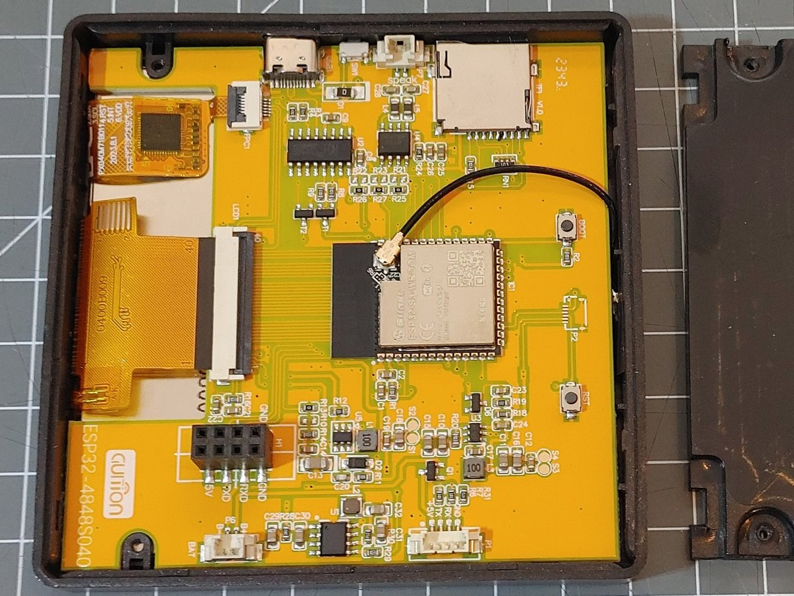 | **ESP32-4848S040**, back: ESP32-S3 module with a wire antenna, microSD slot, USB-C, H1 header |
| 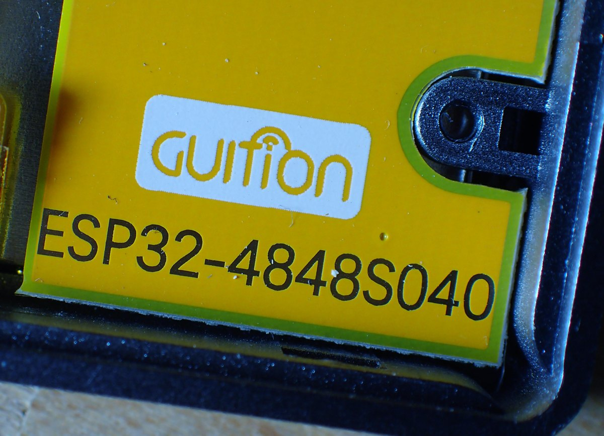 | the marking on the module case — search for it by this name |
|  | **ESP32-S3 N16R8** — the receiver board (two USB-C ports, BOOT and RST buttons, RGB LED) |
|  | **SH1106 1.3″ display with an EC11 encoder** and BACK / CONFIRM buttons |
| 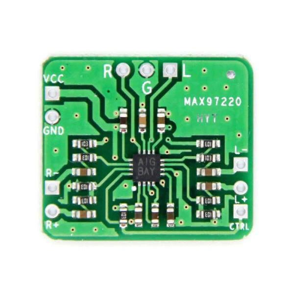 | **MAX97220** (“HYT”) — headphone amplifier (optional): inputs L+, L−, R+, R−, output R, G, L, power VCC, GND, control CTRL |
|  | **PCM1808** — external transmitter ADC (optional) |
| 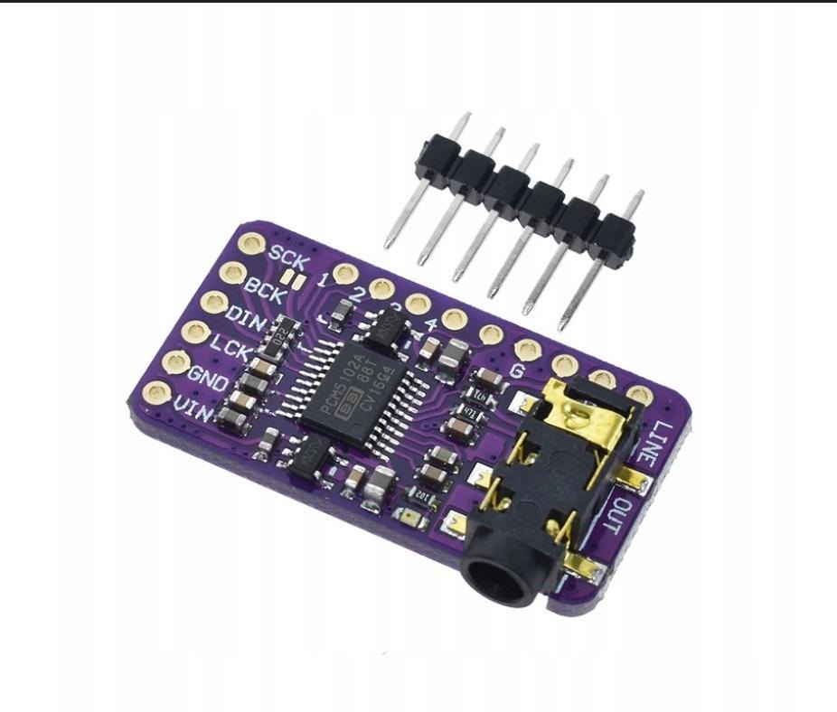 | **PCM5102** — external receiver DAC (optional) |

Module photos belong to their manufacturers and sellers; the project's MIT license does not cover them.

### Drawings with pin labels

Generated by `tools/gen_modules.py`. Part placement is schematic — check the pins against the silkscreen of your own
board.

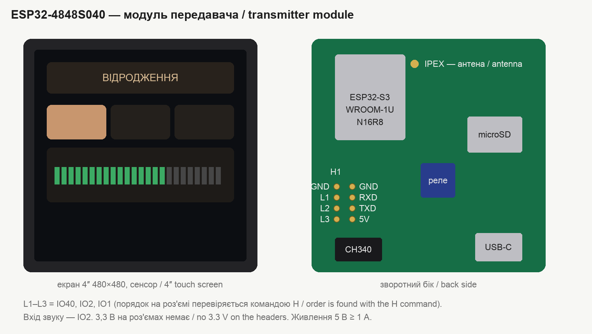
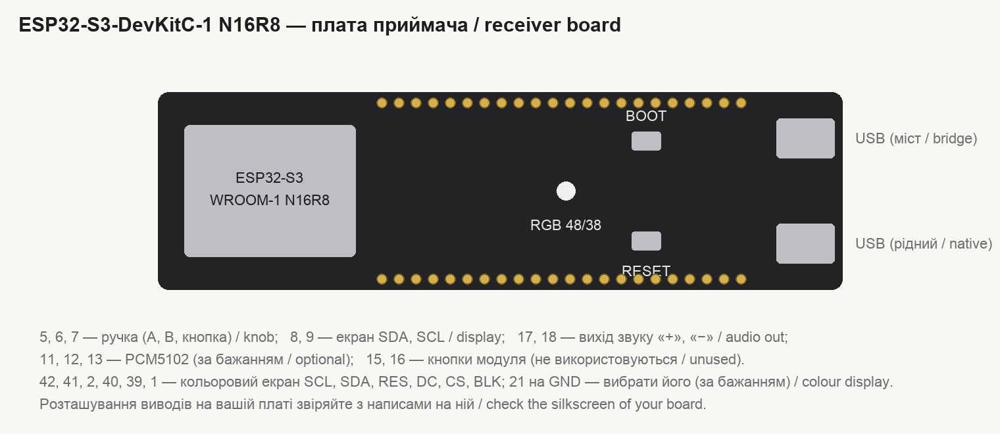
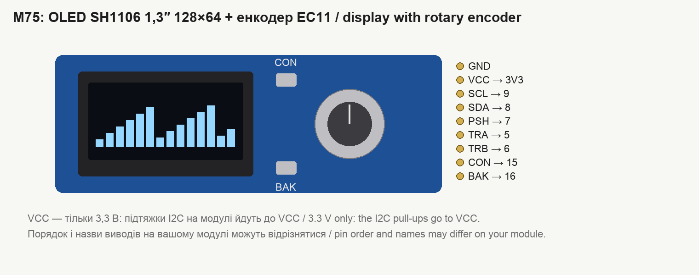
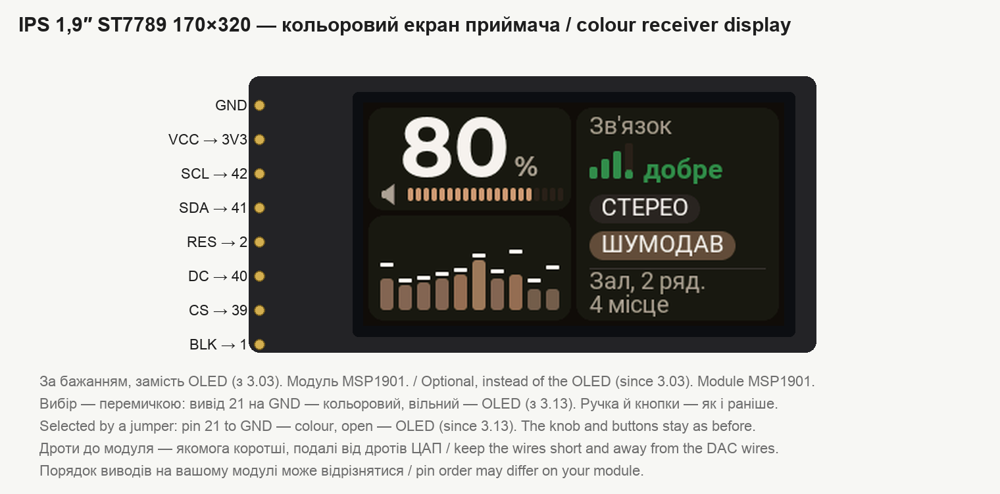
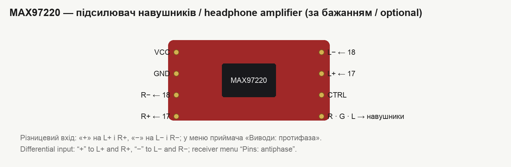
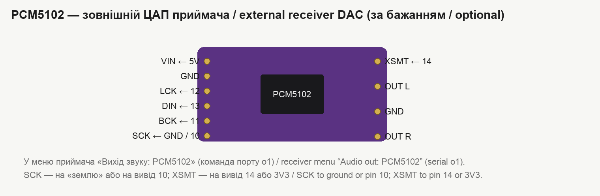
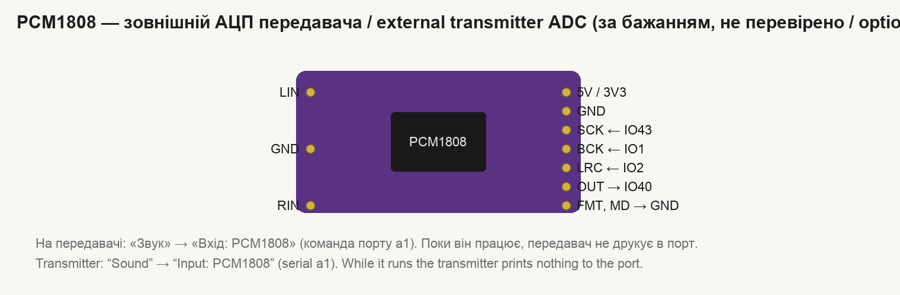

The real appearance of the ESP32-S3-DevKitC-1 is shown in the manufacturer's documentation:
<https://docs.espressif.com/projects/esp-dev-kits/en/latest/esp32s3/esp32-s3-devkitc-1/>. The other modules are
easy to find by name: “ESP32-4848S040”, “SH1106 1.3 OLED EC11”, “MAX97220 module”, “PCM5102 module”, “CS4344 module” (or “Pmod I2S”),
“PCM1808 module”.

## Pins

### Receiver (ESP32-S3)

| Purpose | Pin |
|---|---|
| Display SDA, SCL | 8, 9 |
| Knob: A (TRA), B (TRB), button (PSH) | 5, 6, 7 |
| Module buttons CON, BAK (not used, pulled up) | 15, 16 |
| Audio output "+", "−" (one-bit PDM) | 17, 18 |
| PCM5102: BCK, LCK, DIN, XSMT; SCK — to GND (or to pin 10, held low) | 11, 12, 13, 14 |
| CS4344: MCLK, SCLK, LRCK, SDIN (supply VCC — from 3V3) | 10, 11, 12, 13 |
| On-board RGB LED (WS2812) | 48 (38 on newer boards) |
| Colour IPS 1.9″ display: SCL, SDA, DC, CS, RES, BLK (since 3.03) | 42, 41, 40, 39, 2, 1 |
| Display select jumper: to GND — colour, open — OLED (since 3.13) | 21 |

### Transmitter on the ESP32-4848S040 module

| Purpose | Pin |
|---|---|
| Audio input (built-in ADC) | IO2 |
| PCM1808: MCLK, BCK, LRCK, DOUT | IO43 (TXD), IO1, IO2, IO40 |
| Memory card SPI: SCK, MOSI, MISO, CS | 48, 47, 41, 42 |
| GT911 sensor SDA | 19 |
| Backlight | 38 |

The module has only three free pins: IO1, IO2, IO40 (on the H1 connector they are labeled L1–L3; their order on the
connector is found with the serial command `H`). When the PCM1808 is in use, the serial output (TXD) is taken by the
ADC clock — the transmitter prints nothing to the port but still accepts commands. Since 2.56 the clock is put on this pin only while the
PCM1808 input is actually on air: with the test sound or a card file on air the port works as usual (details at the
top of [“Serial commands”](commands.md)). The built-in ADC is only for checks without an external ADC: with it the
transmitter's radio stalls for 0.2 s now and then (the built-in ADC and the radio share hardware in the chip).

**PCM1808 module pins FMT, MD0, MD1.** MD0 and MD1 go to GND (the transmitter drives the ADC). FMT goes to GND by the
diagram (I2S format), but FMT at 3.3 V (“left-justified”, data one clock earlier) works too: since 3.19 the transmitter
recognises the format by itself, rebuilds the samples and puts left and right back in place (this is the owner's
setup: “with it connected to minus there was no sound at all”). Before 3.19, with FMT at 3.3 V loud passages flipped
their sign — crackling — and the level on the meter read twice too high (`e14`, `e18`).

**Level at the ADC input.** The PCM1808 full scale is 3 V peak-to-peak (at a 5 V supply), i.e. ±1.5 V. A voltmeter shows
an average, and music peaks are 3–4 times higher, so “0.7 V” on a voltmeter is already near full scale. The sign of
overload is the red “ADC clips” on the “Input peaks” page or “at full scale” in `e14`: then lower the mixer output (or
fit 22 kΩ instead of 10 kΩ for R1, R2 at the input — see the diagram). Bass loads the ADC heavily: if the lows are cut by
the transmitter's equalizer anyway, better cut them on the mixer for this line.

**Clocks on the weakest outputs** (since 3.26): the 8.192 MHz clock harmonics fall into the 2.4 GHz band and disturbed
the transmitter's own radio (noise +2–3 dB with the mixer on air). Keep the clock wire to the module short and away
from the antenna.

### Transmitter on a plain ESP32-S3 board (no display)

Audio input — pin 4 (ADC), PCM1808 — 10 (SCK), 11 (BCK), 12 (LRC), 13 (OUT). Control — from the serial port only.

## Schematics

Transmitter on the module with a display, input — built-in ADC:

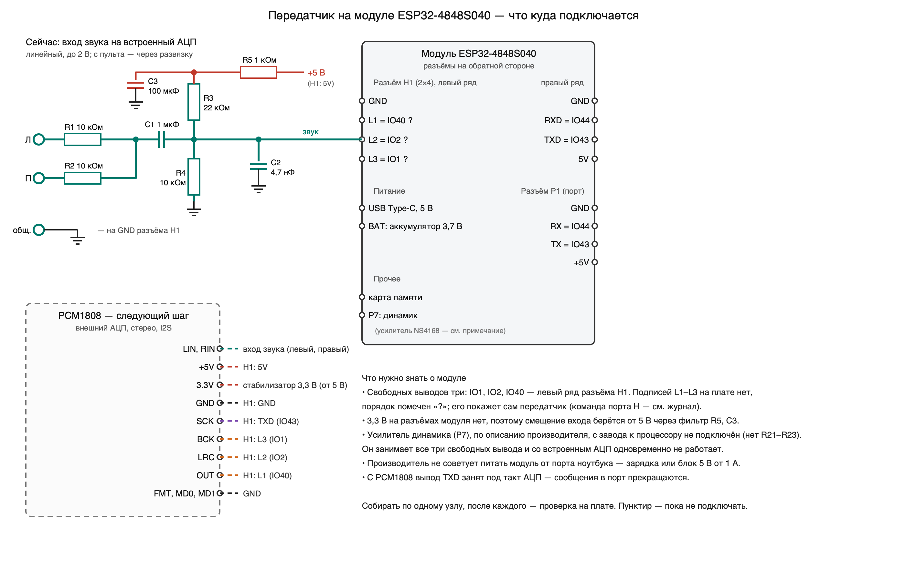

Input: R1, R2 of 10 kΩ each sum the left and right channels of the mixer, R3, R4 of 10 kΩ each set the bias at
mid-level, C1 of 1 µF blocks the DC component, C2 of 4.7 nF cuts off radio frequencies. The signal is attenuated by
half; up to 2 V can be applied to the input.

Receiver, headphones directly to the board:

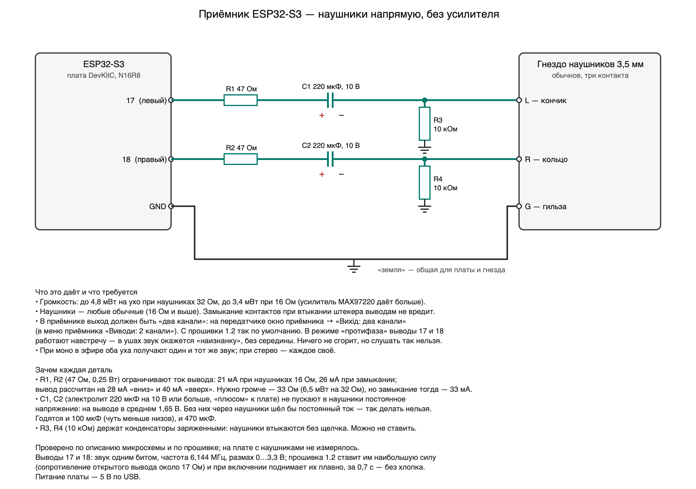

Receiver with a headphone amplifier ("antiphase" output):

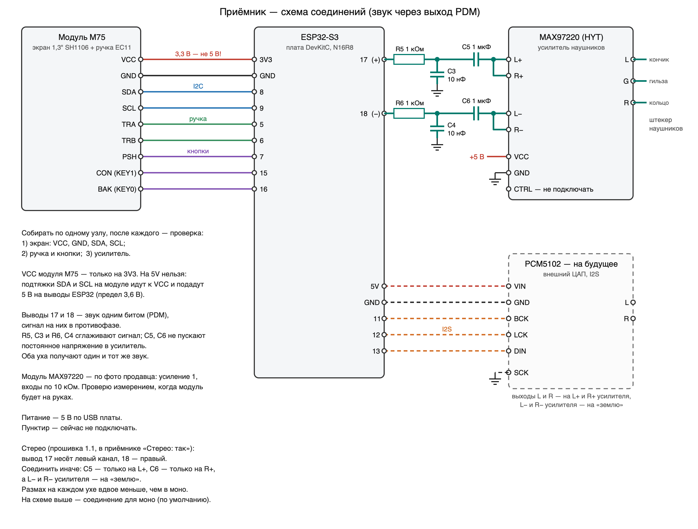

Variants with external converters (not verified on the boards):
[transmitter + PCM1808](../skhema-peredatchik-4848-pcm1808.png),
[receiver + PCM5102](../skhema-priemnik-s3-pcm5102.png), [receiver + CS4344](../skhema-priemnik-s3-cs4344.png),
[receiver + colour display](../skhema-priemnik-s3-ips.png).

The schematics are drawn by `tools/gen_schema.py`; they are also available as SVG.

## External PCM5102 DAC on the receiver

The module is the purple GY-PCM5102 board (PCM5102A, two 3.3 V regulators, a 3.5 mm jack; 470 Ω in series with each
output — which is why headphones can be plugged straight into the jack).

| Module pin | Goes to | Purpose |
|---|---|---|
| VIN | receiver 5V | power (the module has its own 3.3 V regulators) |
| GND | GND | |
| BCK | **11** | bit clock, 1.024 MHz |
| LCK (LRCK) | **12** | word clock, 32 kHz |
| DIN | **13** | I2S data, 16 bit |
| SCK | **GND** (or pin 10 — the receiver holds it low) | no master clock is supplied: the DAC recovers it from BCK |
| XSMT | **14** (or 3V3) | “sound on”. Since 2.63 the receiver holds it at ground from the first line of its start-up and raises it only when sound is actually playing (see “No pops” below) |
| FLT | **GND** or 3V3 — just not floating | digital filter: GND — normal, 3V3 — low latency |
| DEMP | **GND** or 3V3 — just not floating | de-emphasis: GND — off, 3V3 — on (softer treble) |
| FMT | **GND** | I2S format |

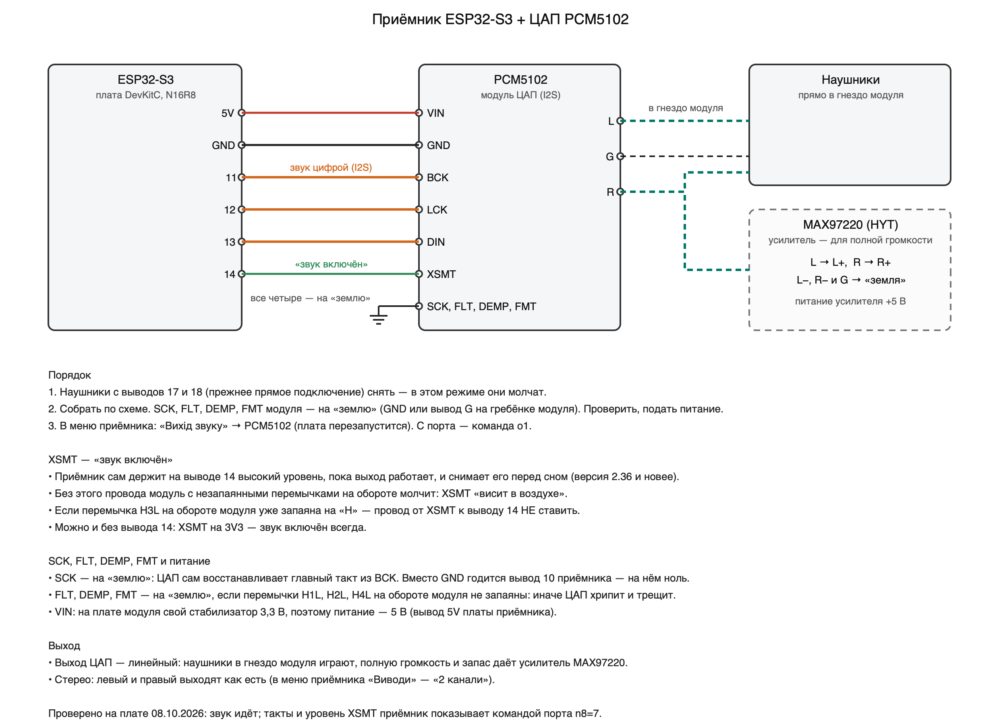

**No pops in the headphones.** For the DAC to stay silent while the receiver boots, XSMT must be wired to pin 14
(not to 3V3 and not bridged to “H” with H3L). Since version 2.63 the firmware: (1) drives pin 14 to ground in the
very first line of its start-up; (2) raises it only when the receiver is running and sound is playing (the splash
and the beginning of “start-up” pass with the DAC muted) and lowers it as soon as work ends; (3) before any restart
of the board mutes the DAC first and holds the pin at ground across the restart. One thing the firmware cannot do:
between power-up and its own start (fractions of a second) the processor pin is not driven at all. If a pop **at
power-up** remains, put a 10–47 kΩ resistor between XSMT and ground: it keeps the DAC muted until the firmware
takes the pin over.

### MAX97220 headphone amplifier after the DAC

From the jack of the PCM5102 module only about 6 % of the DAC voltage reaches 32 Ω headphones: the module has 470 Ω
resistors on its outputs. That is why “full volume” with headphones plugged in directly is quiet, and the digital
«Підсилення» (Boost) cannot help here — nothing digital is louder than the DAC's full scale. The headroom comes from
a headphone amplifier: the MAX97220 module (“HYT”) gives the headphones the whole DAC voltage.

| Module pad | Where to |
|---|---|
| L+, R+ | left and right DAC output |
| L−, R− | DAC ground (AGND) |
| VCC, GND | power; 5 V is better — from 3.3 V the loudest passages may be clipped |
| CTRL | to “plus” — the amplifier is on (according to the chip's data sheet) |
| R, G, L | headphones |

- **The gain of the module is one.** All resistors around the chip are 10 kΩ. The marking “E01” on some of them is
  the same “103” soldered upside down.
- **To raise the gain**, the resistor at the “+” input is reduced: gain = 2 · 10 kΩ / (10 kΩ + R). With 470 Ω it is
  1.9 (+5.6 dB), with a jumper — 2 (+6 dB). But into 32 Ω headphones the chip delivers about 2 V at most from a
  5 V supply, while the DAC gives 2.1 V at full scale — so with a gain of 2 it clips the peaks at high volume. In
  that case set «Межа гучності» (Volume limit) in the receiver to about 85 % (5 V) or 70 % (3.3 V).
- **With the amplifier, keep «Підсилення» (Boost) in the receiver menu at zero** and set the loudness with the
  knob; for listeners it makes sense to restrict «Межа гучності» — 100 % is really loud now.

The figures about voltage and clipping are calculated from the chip's data sheet, not measured on the board.

**The key point: no control pin of the chip may be left floating.** According to the module schematic, four pins
(FLT, DEMP, XSMT, FMT) are set by the solder jumpers H1L–H4L on the back, and the module normally ships with them
closed: H1L → L, H2L → L, H3L → H, H4L → L; SCK is shorted to ground with a solder blob next to the pin. **Some
modules ship with the jumpers open** — then these inputs are undefined (the chip has no internal pull resistors) and
the DAC is either silent (XSMT) or crackles and rasps (FMT, FLT, DEMP pick up noise from the neighbouring lines).
The cure without soldering is jumper wires on the module header: FLT, DEMP and FMT to the adjacent AGND (G) pin of
the same header, XSMT to receiver pin 14. Or close the jumpers as in the table.

| Jumper | DAC pin | Sets | Must be | Otherwise |
|---|---|---|---|---|
| H1L | FLT | digital filter | **L** or **H** | L — normal filter, H — low-latency filter; floating — clicks, “dirt” in the sound |
| H2L | DEMP | 44.1 kHz de-emphasis | **L** or **H** | L — audio as it is, H — softer treble; floating — “dirt” in the sound |
| H3L | XSMT | soft mute | **H** | L or floating — silence |
| H4L | FMT | data format | **L** (I2S) | H — another format: loud noise instead of sound; floating — rasping |

**Verified on the device (2026-10-09).** On a receiver whose module had H1L, H2L and H4L open, the sound carried
digital “dirt”: a background buzz on some harmonics, “as if the sample rate were very low” — although the signal to
the DAC was bit-exact (`n8=9`). After bridging **H1L → H, H2L → H, H4L → L** (H3L → H was already closed) the dirt
was gone and the sound is clean. So all four jumpers must be closed; the kit's working receiver uses exactly this
combination.

About H2L → H: this is the de-emphasis filter designed for 44.1 kHz; at our 32 kHz it softens the treble — by
calculation roughly −2 dB at 2 kHz, −5 dB at 4 kHz, −8 dB at 8 kHz (not measured). If speech lacks clarity, raise the
treble on the receiver (“Clarity”, equalizer bands 2.5 and 6 kHz) or bridge H2L → L.

- If the H3L jumper is bridged to “H”, do **not** connect pin 14 to XSMT; if SCK is already shorted to ground on the
  module, do not wire it anywhere else.
- In the receiver menu: «Вихід звуку» (Audio out) → **PCM5102** (the board restarts); from the serial port — `o1`.
  Headphones on pins 17/18 are silent in this mode.
- The receiver shows what actually goes to the DAC: `n8=7` — whether BCK, LRCK and data are toggling, the SCK and
  XSMT levels; `n8=9` — samples the pins and prints the bits of one word (a format check).
- Documentation: [PCM5102A, Texas Instruments](https://www.ti.com/lit/ds/symlink/pcm5102a.pdf) — operation without
  a master clock (section 9.3.5.3, table 11: 32 kHz with BCK 1.024 or 2.048 MHz), the XSMT input (9.3.3).

## External CS4344 DAC on the receiver (firmware 2.85 and later)

The module is a board with the **CS4344** chip (Cirrus Logic) and a 3.5 mm jack: the Digilent Pmod I2S or its copies,
“CS4344 DAC module”. The header usually has six pins: MCLK, LRCK, SCLK, SDIN, GND, VCC; other boards label them
differently — BCK or BCLK instead of SCLK, WS or LRC instead of LRCK, DIN or SDATA instead of SDIN.

| Module pin | To | Why |
|---|---|---|
| VCC | receiver **3V3** | DAC supply, about 16 mA. If the module has its own regulator and the input is labelled “5V” or “VIN” — the receiver’s 5V |
| GND | GND | |
| MCLK | **10** | master clock 8 MHz — without it the CS4344 stays silent |
| SCLK (BCK, BCLK) | **11** | bit clock, 2 MHz |
| LRCK (WS) | **12** | channel clock, 31.25 kHz |
| SDIN (DIN, SDATA) | **13** | I2S data, 16 bit |

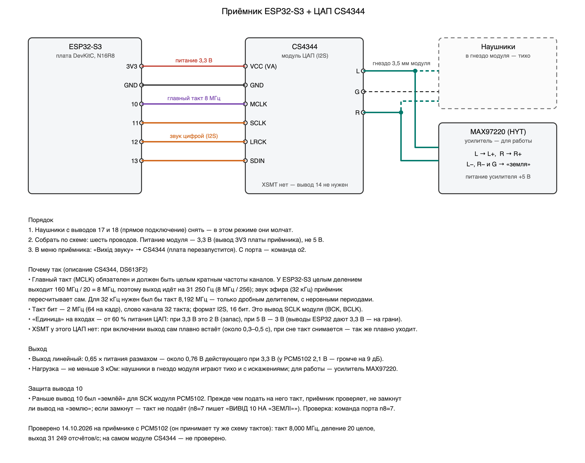

**Supply 3.3 V, not 5 V.** A logic “1” at the CS4344 inputs starts at 60 % of its supply voltage (datasheet, “Digital
input characteristics”). At 3.3 V that is 2 V, and the ESP32-S3 pins have margin; at 5 V it is 3 V while the processor
pin gives 3.3 V — borderline.

**Why the output runs at 31.25 kHz.** The CS4344 requires a master clock (MCLK), and it must be an integer multiple of
the channel rate (section 4.1: “MCLK/LRCK must be an integer ratio”). For the usual 32 kHz that is 8.192 MHz, which the
ESP32-S3 can only make with a fractional divider from 160 MHz — the clock periods are uneven (exactly such a clock made
the PCM5102 rasp in 2.35–2.37). 160 MHz / 20 = 8 MHz divides evenly, and 8 MHz / 256 = 31,250 Hz. The receiver converts
the 32 kHz audio from the air to this rate itself, with the same tempo adjustment that keeps the buffer: one output
sample takes 1.024 input samples instead of one. Audio frequencies do not shift; the band reaches 15.6 kHz.

**Line-level output.** Full-scale swing is 0.65 of the supply voltage: about 0.76 V RMS at 3.3 V (the PCM5102 gives
2.1 V; the CS4344 is 9 dB quieter). Load — at least 3 kΩ, output impedance 100 Ω (“DAC Analog Characteristics”):
headphones plugged straight into the module jack play quietly and distort when loud. For real use — the **MAX97220**
headphone amplifier (as after the PCM5102, section above): left and right module outputs → L+ and R+; L−, R− and the
module ground → ground. The amplifier gain can be raised to 2 (a 470 Ω resistor on the “+” input, or a jumper):
0.76 V × 2 = 1.5 V, below the ~2 V the MAX97220 gives into 32 Ω headphones at 5 V, so it will not clip (calculated,
not measured).

**Pin 14 — “enable” of the headphone amplifier** (since 3.28; the owner: “with the CS4344, use pin 14 to control the
amplifier module: no sound until the device has booted”). The CS4344 has no XSMT pin, so the receiver drives the
amplifier itself with pin 14 — just like XSMT on the PCM5102: ground from the first line of start-up, raised only when
the receiver is working and sound is flowing, ground while waiting, searching, asleep and during any restart. Wire pin
14 to the amplifier's enable input (on the MAX97220 — SHDN: high — on, low — off; amplifier modules label it EN, SD,
SHDN or MUTE). If the module has that input soldered to the supply, unsolder it and take it to pin 14; a click at the
very moment power is applied is removed by a 10–47 kΩ resistor from that input to ground.

**The CS4344 also protects itself from clicks** (Popguard,
section 4.5): when the master clock appears, the output rises smoothly in 0.25 s (0.42 s if the module has 10 µF on VQ),
and sound follows about 2000 samples (≈ 64 ms) later; when the receiver falls asleep and the clock stops, the output
falls just as smoothly. So after power-on or wake-up the sound appears 0.3–0.5 s later than with the PCM5102.

**Pin 10 and the old PCM5102 wiring.** Pin 10 used to be the “ground” for the SCK of the PCM5102 module, and SCK on the
module itself may also be shorted to ground with a solder blob. To avoid driving an 8 MHz clock into a short, the
receiver checks pin 10 before starting the output: it enables a pull-up on it, and if the pin still reads zero it does
not drive the clock there (`n8=7` says «ВИВІД 10 НА «ЗЕМЛІ»», pin 10 on ground); the CS4344 is silent then. A PCM5102
module left in CS4344 mode does play: it takes its clock from BCK or from pin 10.

- In the receiver menu: «Вихід звуку» (Audio out) → **CS4344** (the board restarts; it cycles PDM → PCM5102 → CS4344);
  from the serial port — `o2`. Headphones on pins 17/18 are silent in this mode.
- Check: `n8=7` — whether pins 10–13 toggle, and the line «головний такт: джерело PLL 160 МГц, ділення 20 ціле (дробу
  z=0 y=0 x=0) → 8.000 МГц; …; частота виходу 31250 Гц» (master clock from PLL 160 MHz, integer divider 20, 8.000 MHz,
  output 31,250 Hz); `n8=8` — the real output rate (about 31,250 samples per second).
- Documentation: [CS4344/45/48, Cirrus Logic, DS613F2](https://statics.cirrus.com/pubs/proDatasheet/CS4344-45-48_F2.pdf) — section 4.1 (master clock, Table 1), 4.2 (bit clock,
  “External Serial Clock Mode”), 4.5 (Popguard), the analog characteristics and digital input tables.

**What was verified (14.10.2026).** CS4344 mode on a receiver with a PCM5102 module, which accepts the same clock
scheme: master clock 8.000 MHz (divider 20, no fraction — read from the processor registers), bit clock = master / 4,
output 31,249 samples per second, the tempo adjustment keeps the buffer, sound plays. **Not verified on an actual
CS4344 module** — there is none in the kit.

## Colour IPS 1.9″ display on the receiver (firmware 3.03 and later)

Instead of the OLED, a receiver can have a colour **IPS 1.9″ 170×320 display with an ST7789 controller** — the MSP1901
module ([LCDwiki description](https://www.lcdwiki.com/1.9inch_IPS_Module); an ESP32 example —
[mboehmerm/IPS-Display-ST7789-170x320](https://github.com/mboehmerm/IPS-Display-ST7789-170x320)). The display is
landscape, 320×170; every screen, menu, icon, the splash and the transitions are redrawn for it, in colour. Control is
the same — with the knob (the M75 module or a separate EC11 encoder on the same pins).

| Module pin | To | Why |
|---|---|---|
| VCC | receiver **3V3** | power for the module and the backlight |
| GND | GND | |
| SCL | **42** | SPI clock |
| SDA | **41** | SPI data |
| RES | **2** | reset |
| DC | **40** | command / data |
| CS | **39** | chip select |
| BLK | **1** | backlight: 30 kHz PWM (above hearing), brightness 1…5 |

**The display is selected by a jumper (since 3.13).** Pin **21** connected to GND — the receiver uses the colour
display; pin left open (pulled up inside) — the OLED. It is read at power-up: after fitting or removing the jumper,
restart the receiver. The module cannot be detected in software: it has no read line. If both displays are fitted, the
OLED shows a hint for 10 s while the colour display is in use ("OLED: remove the jumper 21-GND") and goes dark. The
serial command `n14` tells which display is in use. Before 3.13 the display was chosen with the "Screen type" menu item —
it was removed: with only the colour display fitted, there is nothing to switch the menu back with.

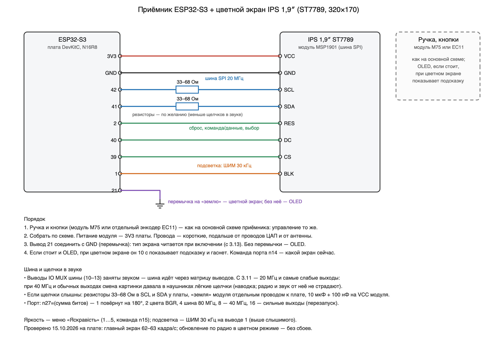

**The bus.** The direct (IO MUX) SPI pins (10–13) are taken by audio, so the bus goes through the GPIO matrix. Since
3.11 it runs at **20 MHz with the weakest output drive** on its lines: at 40 MHz with normal drive, picture changes caused
faint clicks in the headphones (owner, 15.10.2026; measurements showed the radio and the digital audio path are not
affected — it is pick-up after the DAC). After 3.11 — "practically gone, barely noticeable". If you still hear clicks:

- **33–68 Ω** resistors in the SCL and SDA lines next to the board (dashed on the diagram, optional);
- keep the wires to the module as short as possible and away from the DAC wires and the antenna;
- a separate ground wire from the module to the board GND; 10 µF + 100 nF across the module supply.

Module options — serial command `n27=<sum of bits>` (restart): 1 — module rotated by 180°, 2 — BGR colour order (if
red and blue are swapped), 4 — 80 MHz bus, 8 — 40 MHz (as before 3.11), 16 — strong bus outputs (as before 3.11).
Brightness — the "Brightness" menu item or `n15=1…5`.

**What was checked (15.10.2026, receiver 884A94).** Main screen — 62–63 frames per second, 3.6–4.9 ms per frame; only
what changed goes to the display (hundreds of pixels per frame out of 54,400). Firmware updates over the air in colour
mode — six in a row without a failure. Sleep and wake — as with the OLED.

## Two ways to connect headphones

In the receiver menu «Виводи» (Pins) (and on the transmitter: receiver window → «Налаштування» (Settings) →
«Вихід звуку» (Audio output)):

- **«2 канали» (2 channels)** — the left channel on pin 17, the right one on pin 18; headphones directly or a stereo
  amplifier. Stereo and balance work.
- **«протифаза» (antiphase)** — one and the same sound on both pins in antiphase: twice the swing for an amplifier
  with a differential input. With headphones connected directly, the sound in this mode is "inside out" — do not
  turn it on.

Pins 17 and 18 are set to the highest drive current (up to 40 mA). The volume in directly connected headphones
depends on their impedance: with 32 Ω it is quieter than with an amplifier.

## Assembly sequence

1. First flash the board ([Installation](install.md)) and make sure it starts.
2. Connect **the display only** — check the splash screen. Then the knob. Then the audio. One part at a time: this
   way you can see exactly what does not work.
3. Before applying power, check that the display VCC is on 3V3, not on 5V.
   The colour display is also powered from 3V3; fit the 21 → GND jumper together with it.
4. Connect the audio from the mixer last, starting from a low level.
