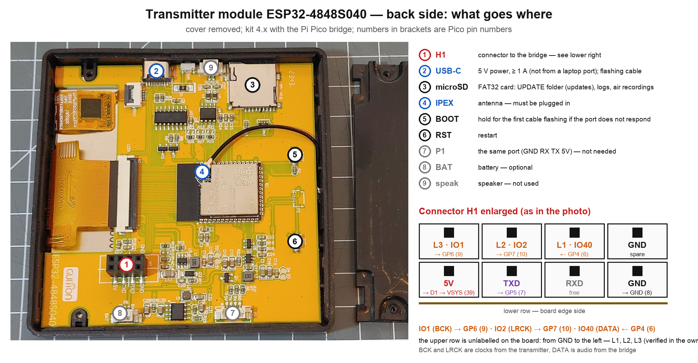
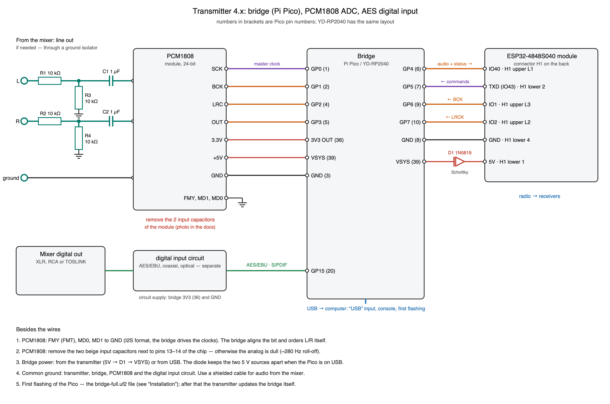
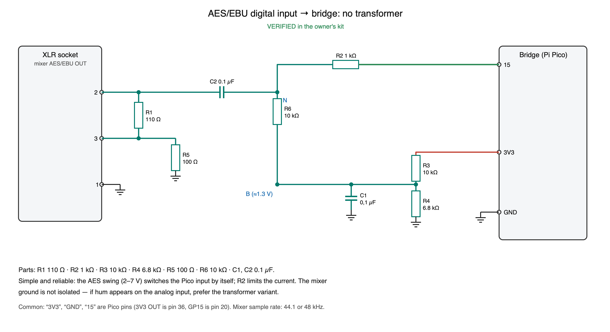
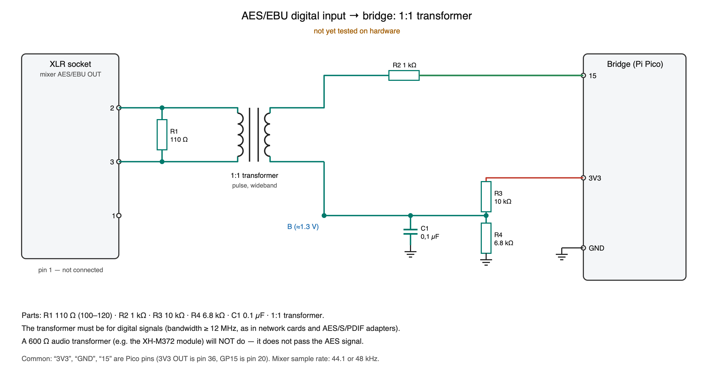
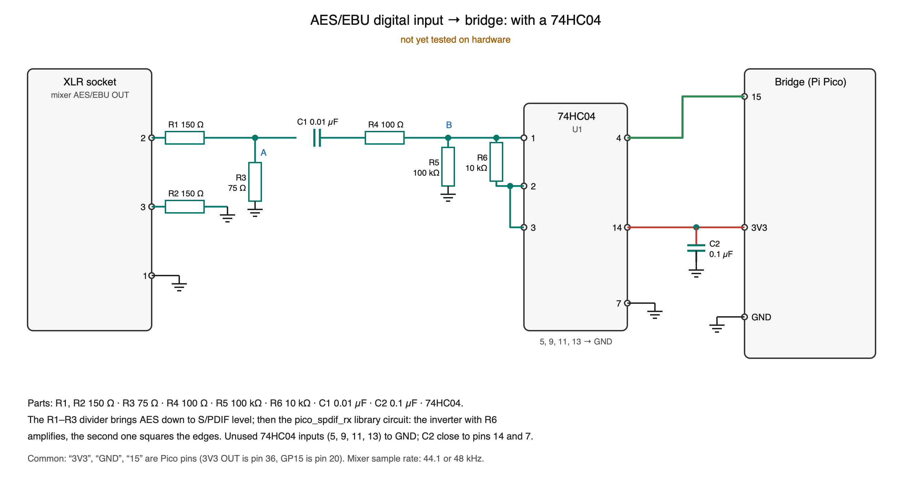
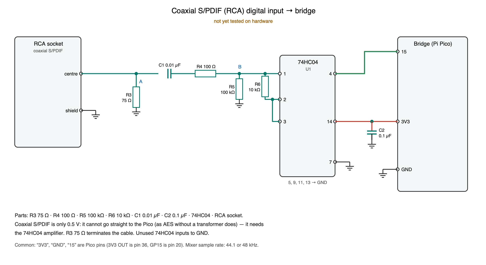
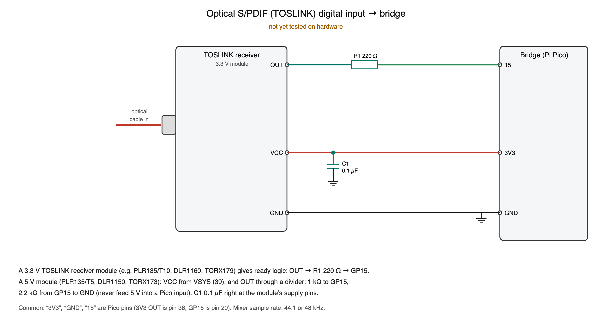

# Kit 4.x “Next Edition”: bridge, inputs, schematics, upgrading from 3.x

[← back to the main page](../../README.md) · [Українська](../uk/next-edition.md)

In version 4 a **bridge** sits between the mixer and the transmitter: a Raspberry Pi Pico board (or the compatible
YD-RP2040). It takes sound from three sources and hands the transmitter ready digital samples:

- **digital input**: AES/EBU (XLR) or S/PDIF (coaxial RCA or optical TOSLINK) straight from the mixer, 24-bit,
  44.1 or 48 kHz;
- **analog input**: the mixer's line out through a PCM1808 ADC (24-bit, 48.8 kHz);
- **USB input**: the computer sees the bridge as a sound card (48 kHz) and can record what goes on air.

## How 4.x differs from 3.x

| | 3.29 (first modification) | 4.00 (Next Edition) |
|---|---|---|
| Sound source | PCM1808 ADC or the built-in ADC right on the transmitter | bridge: digital AES/S/PDIF, analog PCM1808, USB |
| Path resolution | 16-bit | 24-bit from the input up to the transmitter's gain |
| Sample rate | 32 kHz | 32 kHz; the “Monitor” quality is 48 kHz / 24-bit |
| Transmitter USB port | silent while PCM1808 is on air (pin 43 carries the ADC clock) | always works (pin 43 carries the bridge commands) |
| Analog input noise | transmitter radio hum −96 dB | the bridge learns and subtracts the radio hum: −108 dB |
| Input choice on screen | “From mixer / Test / Silence” | “Analog input · Digital input · USB input · Test · Silence” |
| Updates | transmitter from the card, receivers by radio | the same + the bridge: the transmitter rewrites its program itself |
| Compatibility | — | 4.x files are not offered to a 3.x transmitter (different tag), see [Upgrading](#upgrading-from-3x-to-400) |

The receivers are the same: same board, same firmware (one for all boards), same headphone and DAC schematics.

## What to buy and modify

| What | Qty | Why |
|---|---|---|
| Raspberry Pi Pico or **YD-RP2040** (tested) | 1 | the bridge; the YD-RP2040 has a USR button and an RGB LED that the bridge uses |
| 1N5819 (or SS14) Schottky diode | 1 | powering the bridge from the transmitter (see the schematic) |
| PCM1808 module | 1 | analog input (if needed) — **modified, see below** |
| digital input parts | per variant | [Digital input — variants](#digital-input--variants) |
| 6-wire lead, 2×4 connector (2.54 mm pitch) | 1 | transmitter ↔ bridge |

**PCM1808 module modification** — required for the analog input:

1. Pins **FMY (FMT), MD0, MD1 to GND.** I2S format, the bridge drives the clocks. The bridge aligns the data by one bit
   and puts the left and right channels in place itself.
2. **Remove the two beige capacitors** next to pins 13–14 of the chip (the VINL/VINR inputs). Together with the input
   divider they formed a ~280 Hz low-pass filter: the analog sounded dull, “as if everything but the lows were muffled”.
   After removal — full bandwidth (the owner, 24.10: “the analog sound became cleaner and louder”). The PCM1808's own
   anti-aliasing filter (1.3 MHz) remains.

## Transmitter back side: what goes where

Connector **H1** (2 × 4 sockets). The lower row (nearer the board edge) is printed on the board: **5V · TXD · RXD ·
GND**. In the upper row only the right socket is marked — **GND**; from it to the left come **L1 = IO40, L2 = IO2,
L3 = IO1** (verified in the owner's kit). So the upper row, left to right: IO1 · IO2 · IO40 · GND.

## Bridge wiring

Numbers in brackets are Pico pin numbers (the YD-RP2040 has the same layout).

**Transmitter ↔ bridge**

| Transmitter (H1) | Bridge | Signal |
|---|---|---|
| L3 = IO1 (upper row, 1st from the left) | GP6 (9) | BCK clock → bridge |
| L2 = IO2 (upper row, 2nd) | GP7 (10) | LRCK clock → bridge |
| L1 = IO40 (upper row, 3rd, next to GND) | GP4 (6) | audio and bridge status → transmitter |
| TXD = IO43 (lower row, 2nd from the left) | GP5 (7) | commands → bridge (UART 115 200) |
| GND (lower row, 4th) | GND (8) | ground |
| 5V (lower row, 1st) | through diode D1 → VSYS (39) | bridge power |

**PCM1808 ↔ bridge**

| PCM1808 | Bridge | |
|---|---|---|
| SCK | GP0 (1) | 12.5 MHz master clock |
| BCK | GP1 (2) | |
| LRC | GP2 (4) | |
| OUT | GP3 (5) | |
| 3.3V | 3V3 OUT (36) | |
| +5V | VSYS (39) | ADC analog section |
| GND | GND (3) | |
| FMY, MD1, MD0 | GND | |

**PCM1808 analog input.** Per channel a 10 kΩ / 10 kΩ divider (up to 2 V from the mixer) and a 1 µF coupling
capacitor, as in the schematic. Use a shielded cable from the mixer. If you hear ground hum, an audio ground isolator
(1:1 transformer, e.g. the XH-M372 module) can be added — **on the analog input only**: it does not pass the digital
signal.

**Power.** The bridge is powered from the transmitter: 5V → diode D1 (anode to the transmitter) → VSYS. The diode is
needed because the Pico may also be connected to a computer by USB — then the two 5 V sources are not tied directly.
Without the diode, do not feed the transmitter's 5 V into VSYS while the Pico is on a computer's USB. Ground is common
to everything.

**The bridge's USB** — to a computer, optional: the “USB” input (the computer plays on air), recording “What goes on
air”, the bridge log and single-letter commands on its port. The kit works without it.

## Digital input — variants

The bridge input is pin **GP15 (pin 20)**, 3.3 V logic with a Schmitt trigger. The bridge accepts **44.1 and 48 kHz**
(set the mixer to 48 kHz). Only the first variant is verified in the owner's kit; the others are built from the
`pico_spdif_rx` library circuits and calculation and are not yet tested on hardware.

| Mixer output | Variant | Parts | Ground isolation | Status |
|---|---|---|---|---|
| AES/EBU, XLR | [no transformer](#1-aesebu-without-a-transformer) | 6 resistors, 2 capacitors | no | **verified** |
| AES/EBU, XLR | [1:1 transformer](#2-aesebu-through-a-11-transformer) | pulse transformer + 4 resistors | yes | not tested |
| AES/EBU, XLR | [74HC04](#3-aesebu-through-a-74hc04) | IC + 6 resistors | no (or with a transformer) | not tested |
| S/PDIF, RCA (coaxial) | [74HC04](#4-coaxial-spdif-rca) | IC + 4 resistors | no | not tested |
| S/PDIF, TOSLINK (optical) | [receiver module](#5-optical-spdif-toslink) | ready module + resistor | complete (light) | not tested |

Tip: if the mixer has an **optical** output, it is the simplest and hum-free option (the mixer ground never reaches
the kit). For XLR without ICs — variant 1; for permanent use with isolation — variant 2.

### 1. AES/EBU without a transformer

### 2. AES/EBU through a 1:1 transformer

### 3. AES/EBU through a 74HC04

### 4. Coaxial S/PDIF (RCA)

Coaxial S/PDIF has only a 0.5 V swing: on its own (like AES in variant 1) it will not switch the Pico input, so it needs
the 74HC04 inverter amplifier. Cable: 75 Ω (RCA video cable).

### 5. Optical S/PDIF (TOSLINK)

A TOSLINK receiver module (sold as “TOSLINK receiver”, “optical S/PDIF receiver”; chips PLR135, DLR1160, TORX17x)
already has an amplifier and outputs a logic signal. A 3.3 V module: output through 220 Ω straight to GP15. A 5 V
module: power from VSYS (39), and the output through a 1 kΩ / 2.2 kΩ divider, because 5 V must never reach a Pico input.

## Checks after assembly

1. Transmitter on, bridge connected. The transmitter home page shows “Analog input”, “Digital input”, “USB input”.
2. **Digital input** — tap “Digital input”: the “Digital input level (AES, 48 kHz)” meter moves with the mixer sound.
   If it says “no signal”, see [Troubleshooting](troubleshooting.md#kit-4x-bridge).
3. **Analog input** — “Analog input”: level and spectrum on the Sound tab. Dull — the module capacitors are still there.
4. Transmitter port (115 200): command `C` — bridge status (inputs, AES rate, its program version and CRC).
5. Bridge test signal through the whole path: `C4` (1 kHz tone), `C5` (pink noise), `C3` — off.

## Upgrading from 3.x to 4.00

A 3.29 transmitter takes only first-modification files from the card, so **4.00 goes onto the transmitter once by
cable**. After that everything is as usual: the transmitter updates the receivers by radio and the bridge over the
command wire.

1. **No need to save the settings** — cable flashing does not erase them (kit key, receiver list, names and channel
   stay). Just do not run a full erase (`erase-flash`).
2. **Build the bridge** using the schematics above (modify the PCM1808, build a digital input variant).
3. **Flash the bridge** (once) with `bridge-full.uf2` — [Installation → Bridge](install.md#bridge-raspberry-pi-pico).
4. **Flash the transmitter with 4.00 by cable** — [Installation → Transmitter](install.md#transmitter). The sounds file
   `assets.bin` can be skipped if it is already there.
5. **Connect the bridge to the transmitter** (table above) and switch on. If the bridge holds a different program than
   the one built into the transmitter firmware, the transmitter rewrites it itself (~15 s, progress on screen).
6. **Receivers** — nothing to do by hand: switched-on 3.x receivers are updated by the transmitter over the radio
   (automatic update is on out of the box; manually — “Receivers” → “Update” → “Update”).
7. Check — the section above.

**Further updates** — no cable: the `hearlink-4.xx.bin` file into the `UPDATE` folder on the card → the transmitter
offers “Update” → first the receivers by radio, then the transmitter itself, then the bridge.

**Going back to 3.29:** the 3.29 flashing kit from the [v3.29 release](../../../releases/tag/v3.29) — by cable onto the
transmitter, then by cable onto each receiver (a 3.x transmitter sends nothing to receivers with newer firmware). 3.29
needs no bridge: the PCM1808 is then connected straight to the transmitter as in 3.x (branch `first-edition`).
