# Набір 4.x «Next Edition»: міст, входи, схеми, перехід із 3.x

[← до головної](../../README.uk.md) · [English](../en/next-edition.md)

У версії 4 між пультом і передавачем стоїть **міст** — плата Raspberry Pi Pico (або сумісна YD-RP2040). Він приймає
звук із трьох джерел і віддає передавачу вже готові цифрові відліки:

- **цифровий вхід** — AES/EBU (XLR) або S/PDIF (коаксіальний RCA чи оптичний TOSLINK) прямо з пульта, 24 біти,
  44,1 або 48 кГц;
- **аналоговий вхід** — лінійний вихід пульта через АЦП PCM1808 (24 біти, 48,8 кГц);
- **вхід USB** — комп'ютер бачить міст як звукову карту (48 кГц) і може записувати те, що йде в ефір.

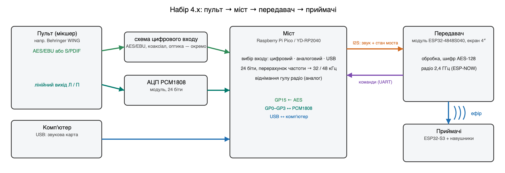

## Чим 4.x відрізняється від 3.x

| | 3.29 (перша модифікація) | 4.00 (Next Edition) |
|---|---|---|
| Звідки звук | АЦП PCM1808 або вбудований АЦП прямо на передавачі | міст: цифровий AES/S/PDIF, аналоговий PCM1808, USB |
| Розрядність тракту | 16 біт | 24 біти від входу до підсилення передавача |
| Частота | 32 кГц | 32 кГц, а в якості «Монітор» — 48 кГц / 24 біти |
| Порт USB передавача | німий, поки в ефірі PCM1808 (вивід 43 — такт АЦП) | працює завжди (вивід 43 — команди мосту) |
| Шум аналогового входу | гул радіо передавача −96 дБ | міст вчить і віднімає гул радіо: −108 дБ |
| Вибір входу на екрані | «З пульта / Перевірка / Тиша» | «Аналоговий вхід · Цифровий вхід · USB вхід · Перевірка · Тиша» |
| Оновлення | передавач — з картки, приймачі — по радіо | те саме + міст: передавач сам переписує його програму |
| Сумісність | — | файли 4.x передавачу 3.x не пропонуються (інша мітка), див. [Перехід](#перехід-із-3x-на-400) |

Приймачі ті самі: та сама плата, та сама прошивка (одна на всі плати), ті самі схеми навушників і ЦАП.

## Що докупити й переробити

| Що | Скільки | Навіщо |
|---|---|---|
| Raspberry Pi Pico або **YD-RP2040** (перевірено) | 1 | міст; у YD-RP2040 є кнопка USR і кольоровий світлодіод — міст ними користується |
| діод Шотткі 1N5819 (або SS14) | 1 | живлення моста від передавача (див. схему) |
| модуль PCM1808 | 1 | аналоговий вхід (якщо потрібен) — **з переробкою, див. нижче** |
| деталі цифрового входу | за варіантом | [Цифровий вхід — варіанти](#цифровий-вхід--варіанти) |
| провід 6 жил, роз'єм 2×4 (крок 2,54) | 1 | передавач ↔ міст |

**Переробка модуля PCM1808** — обов'язкова для аналогового входу:

1. Виводи **FMY (FMT), MD0, MD1 — на GND.** Формат I2S, такти дає міст. Міст сам вирівнює дані на біт і ставить
   лівий і правий канали на місце.
2. **Зняти два бежеві конденсатори** біля ніжок 13–14 мікросхеми (входи VINL/VINR). Разом із дільником на вході вони
   робили фільтр нижніх частот ~280 Гц: аналог звучав глухо, «наче все, крім низів, заглушено». Після зняття —
   повна смуга (у власника 24.10: «звук з аналога став чистішим і гучнішим»). Вбудований фільтр PCM1808 від
   накладання (1,3 МГц) лишається.

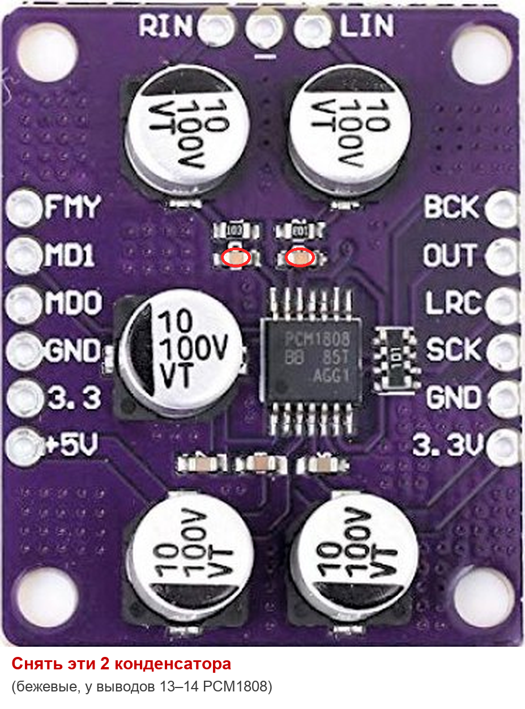

## Плата моста: Raspberry Pi Pico / YD-RP2040

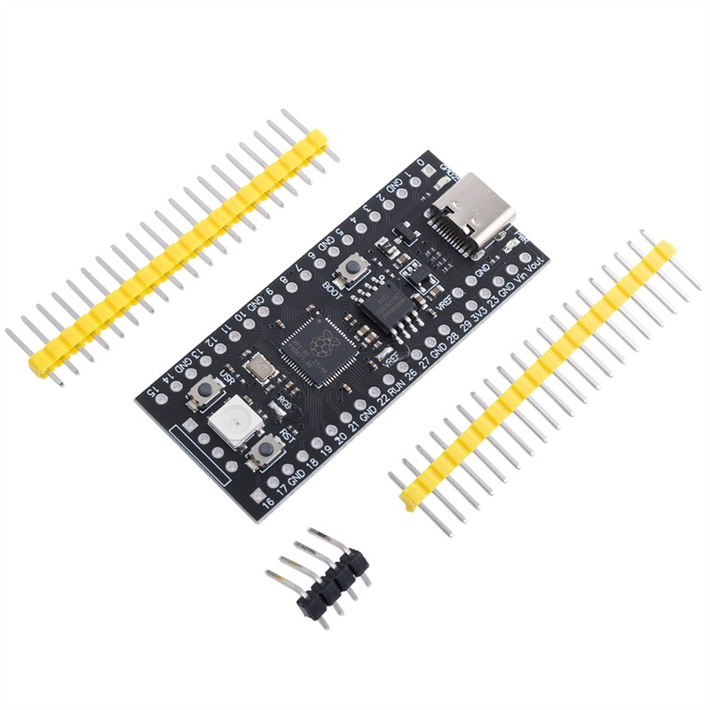

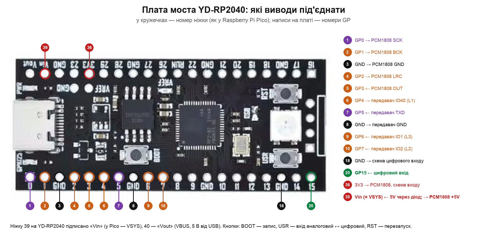

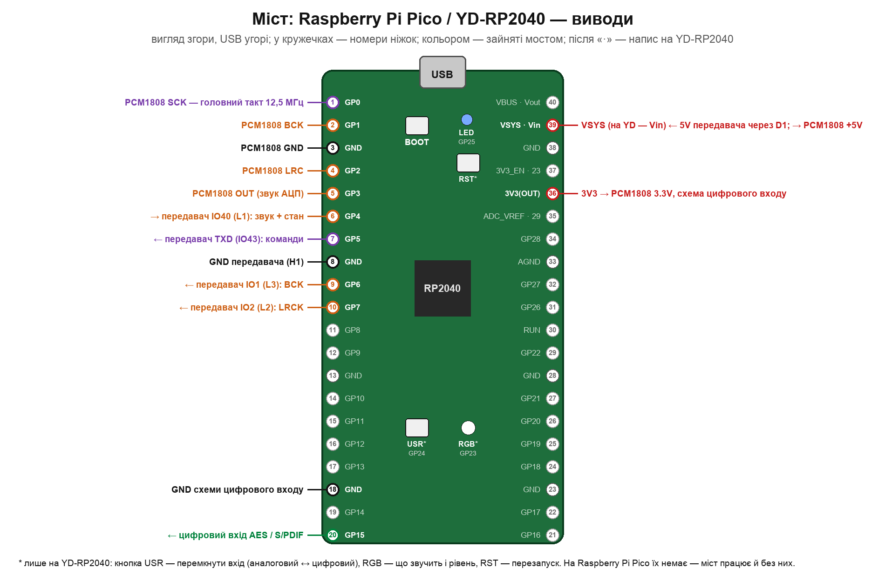

**Увага до написів YD-RP2040:** ніжку 39 (VSYS у Pico) на ній підписано **«Vin»**, ніжку 40 (VBUS) — **«Vout»**
(це 5 В від USB — сюди нічого не подавати); на місці 3V3_EN і ADC_VREF у неї виведено GP23 і GP29. Решта написів —
номери GP, як у Pico.

**Що це.** Raspberry Pi Pico — маленька плата (51 × 21 мм) з мікроконтролером RP2040 (два ядра, програмовані блоки
введення-виведення PIO), 2 МБ флешу, роз'ємом USB і 40 виводами по краях (крок 2,54 мм — можна паяти дроти або гребінку).
**YD-RP2040** (VCC-GND Studio) — її копія з тією самою розкладкою виводів, з USB-C, 4 або 16 МБ флешу, кнопками RST і
USR і кольоровим світлодіодом; на ній міст і перевірено. Продаються в Україні як «Raspberry Pi Pico», «RP2040 Pico»,
«YD-RP2040».

| Плата | Чи годиться |
|---|---|
| YD-RP2040 (4 або 16 МБ) | так — перевірено; є кнопка USR і кольоровий світлодіод |
| Raspberry Pi Pico, Pico H | так — та сама розкладка; без кнопки USR і кольорового світлодіода (вони не обов'язкові) |
| Raspberry Pi Pico W, Pico 2 / RP2350 | ні — інший чип або виводи 23–25 зайняті радіомодулем |

**Що де на платі.** Згори — роз'єм USB; ліворуч ніжки 1–20 (GP0…GP15), праворуч 21–40 (живлення VBUS, VSYS, 3V3 і
GP16…GP28). Номер ніжки надруковано на звороті плати біля кожного виводу. Мосту потрібні: ніжки 1–10 (PCM1808 і
передавач), 18 і 20 (цифровий вхід), 36 і 39 (живлення). Решта вільні.

**Кнопки.** **BOOT** — утримувати під час під'єднання USB, щоб записати програму вперше. **USR** (лише YD-RP2040) —
клацання перемикає вхід «аналоговий ↔ цифровий» (передавач теж перемикається; білий спалах — натиск прийнято).
**RST** (YD-RP2040) — перезапуск.

**Світлодіоди.** Синій (GP25): спалах раз на секунду — міст працює; два спалахи — грає цифровий вхід; часто — немає
тактів від передавача (перевірте проводи IO1, IO2). Кольоровий (лише YD-RP2040), яскравість — за рівнем звуку:

| Колір | Що означає |
|---|---|
| зелений | звучить цифровий вхід |
| синій | звучить аналоговий вхід |
| фіолетовий | звучить вхід USB |
| жовтогарячий | перевірочний сигнал моста |
| червоний, блимає | немає зв'язку з передавачем |
| червоний, горить | перевантаження входу (край шкали) |
| жовтогарячий, блимає | обрано цифровий вхід, але сигналу немає |
| фіолетовий, блимає | обрано USB, але комп'ютер не грає |

## Зворотний бік передавача: куди що підключати

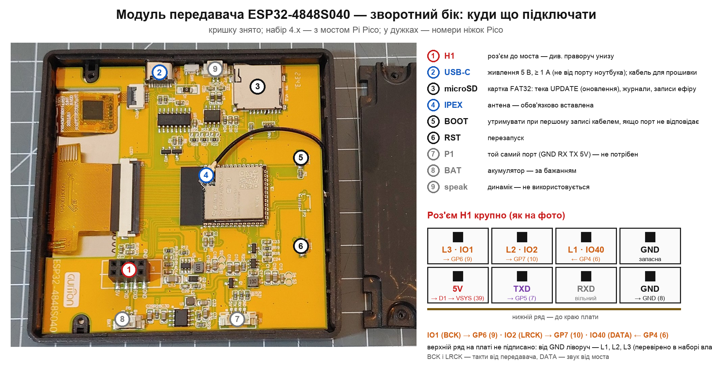

Роз'єм **H1** (2 × 4 гнізда). Нижній ряд (ближче до краю плати) підписано на платі: **5V · TXD · RXD · GND**.
Верхній ряд підписано лише праве гніздо — **GND**; від нього ліворуч ідуть **L1 = IO40, L2 = IO2, L3 = IO1**
(перевірено в наборі власника). Отже, верхній ряд зліва направо: IO1 · IO2 · IO40 · GND.

## Підключення моста

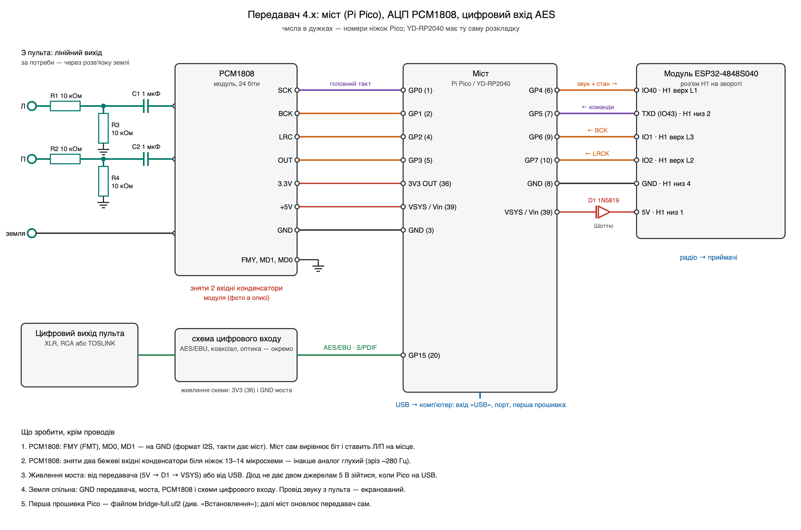

У дужках — номер ніжки Pico (YD-RP2040 має ту саму розкладку).

**Передавач ↔ міст**

| Передавач (H1) | Міст | Що йде |
|---|---|---|
| L3 = IO1 (верхній ряд, 1-й зліва) | GP6 (9) | такт BCK → міст |
| L2 = IO2 (верхній ряд, 2-й) | GP7 (10) | такт LRCK → міст |
| L1 = IO40 (верхній ряд, 3-й, поруч із GND) | GP4 (6) | звук і стан моста → передавач |
| TXD = IO43 (нижній ряд, 2-й зліва) | GP5 (7) | команди → міст (UART 115 200) |
| GND (нижній ряд, 4-й) | GND (8) | земля |
| 5V (нижній ряд, 1-й) | через діод D1 → VSYS (39; на YD-RP2040 «Vin») | живлення моста |

**PCM1808 ↔ міст**

| PCM1808 | Міст | |
|---|---|---|
| SCK | GP0 (1) | головний такт 12,5 МГц |
| BCK | GP1 (2) | |
| LRC | GP2 (4) | |
| OUT | GP3 (5) | |
| 3.3V | 3V3 OUT (36) | |
| +5V | VSYS (39; на YD-RP2040 «Vin») | аналогова частина АЦП |
| GND | GND (3) | |
| FMY, MD1, MD0 | GND | |

**Аналоговий вхід PCM1808.** На кожен канал — дільник 10 кОм / 10 кОм (до 2 В з пульта) і розділовий конденсатор
1 мкФ, як на схемі. Провід від пульта — екранований. Якщо чутно гул «землі», можна поставити звукову розв'язку землі
(трансформатор 1:1, напр. модуль XH-M372) — **лише на аналоговий вхід**: цифровий сигнал вона не пропускає.

**Живлення.** Міст живиться від передавача: 5V → діод D1 (анодом до передавача) → VSYS. Діод потрібен, бо Pico
буває під'єднано ще й до комп'ютера кабелем USB — тоді два джерела 5 В не з'єднуються напряму. Без діода 5 В
передавача на VSYS не подавати, поки Pico на USB комп'ютера. Земля спільна для всього.

**USB моста** — до комп'ютера за бажанням: вхід «USB» (комп'ютер грає в ефір), запис «Що йде в ефір», журнал моста й
команди-букви в порту. Для роботи набору USB моста не потрібен.

## Цифровий вхід — варіанти

Вхід моста — вивід **GP15 (ніжка 20)**, логіка 3,3 В з тригером Шмітта. Міст бере частоти **44,1 і 48 кГц** (на пульті
— 48 кГц). Перевірено в наборі власника лише перший варіант; решта зібрані за схемами бібліотеки `pico_spdif_rx` і
розрахунком, на приладі ще не перевірені.

| Вихід пульта | Варіант | Деталі | Розв'язка землі | Стан |
|---|---|---|---|---|
| AES/EBU, XLR | [без трансформатора](#1-aesebu-без-трансформатора) | 6 резисторів, 2 конденсатори | ні | **перевірено** |
| AES/EBU, XLR | [трансформатор 1:1](#2-aesebu-через-трансформатор-11) | імпульсний трансформатор + 4 резистори | так | не перевірено |
| AES/EBU, XLR | [74HC04](#3-aesebu-через-74hc04) | мікросхема + 6 резисторів | ні (або з трансформатором) | не перевірено |
| S/PDIF, RCA (коаксіал) | [74HC04](#4-spdif-коаксіальний-rca) | мікросхема + 4 резистори | ні | не перевірено |
| S/PDIF, TOSLINK (оптика) | [модуль-приймач](#5-spdif-оптичний-toslink) | готовий модуль + резистор | повна (світло) | не перевірено |

Порада: якщо пульт має **оптичний** вихід — це найпростіше й без жодного гулу (земля пульта до набору не доходить).
Для XLR без мікросхем — варіант 1; для постійної роботи з розв'язкою — варіант 2.

### 1. AES/EBU без трансформатора

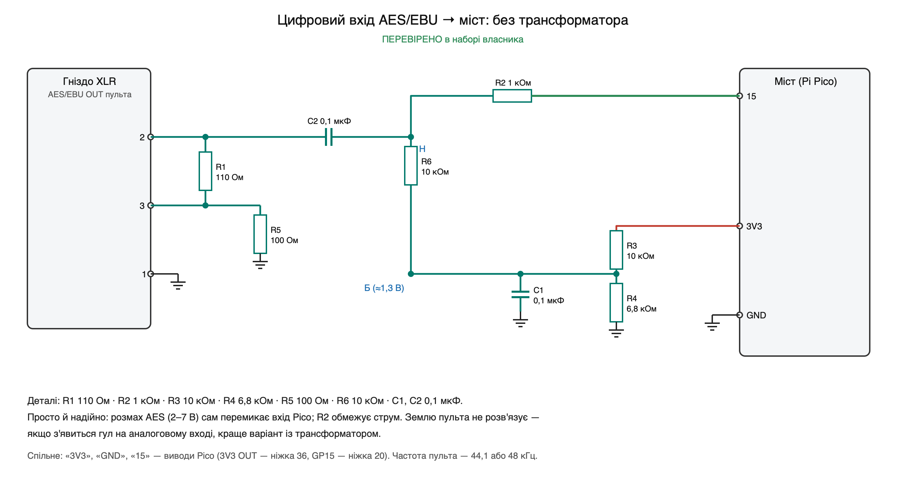

### 2. AES/EBU через трансформатор 1:1

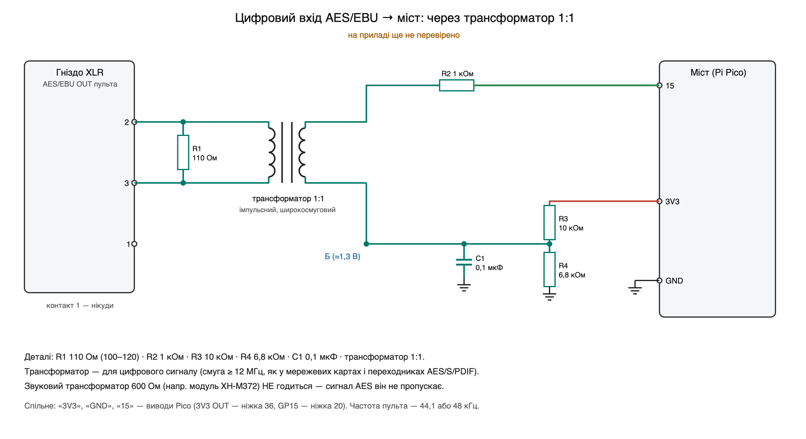

### 3. AES/EBU через 74HC04

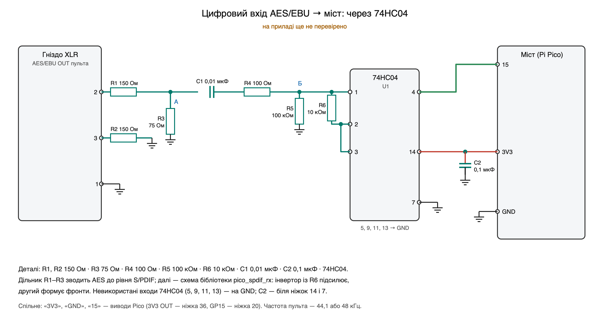

### 4. S/PDIF коаксіальний (RCA)

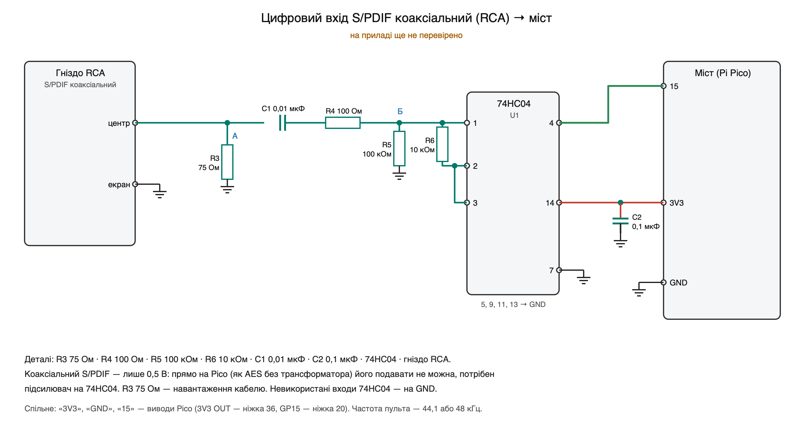

Коаксіальний S/PDIF — лише 0,5 В розмаху: напряму (як AES у варіанті 1) він вхід Pico не перемкне, потрібен
підсилювач на інверторі 74HC04. Кабель — 75 Ом (відеокабель із RCA).

### 5. S/PDIF оптичний (TOSLINK)

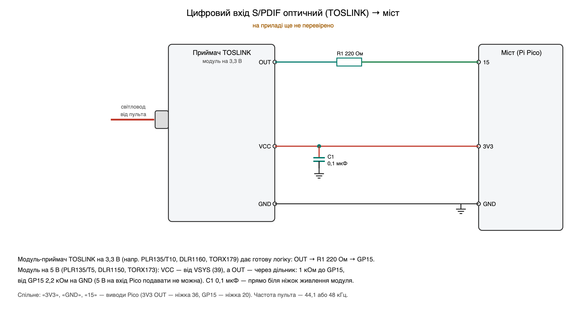

Модуль-приймач TOSLINK (продається як «TOSLINK receiver», «оптичний приймач S/PDIF»; мікросхеми PLR135, DLR1160,
TORX17x) уже має підсилювач і дає логічний сигнал. Модуль на 3,3 В — вихід через 220 Ом прямо на GP15. Модуль на 5 В
— живлення від VSYS (39), а вихід — через дільник 1 кОм / 2,2 кОм, бо 5 В на вхід Pico подавати не можна.

## Перевірка після збирання

1. Передавач увімкнено, міст під'єднано. На головній передавача кнопки «Аналоговий вхід», «Цифровий вхід», «USB вхід».
2. **Цифровий вхід** — натиснути «Цифровий вхід»: шкала «Рівень цифрового входу (AES, 48 кГц)» рухається зі звуком
   пульта. Якщо «немає сигналу» — дивіться [Несправності](troubleshooting.md#набір-4x-міст).
3. **Аналоговий вхід** — «Аналоговий вхід»: рівень і спектр на вкладці «Звук». Глухо — не зняті конденсатори модуля.
4. Порт передавача (115 200): команда `C` — стан моста (входи, частота AES, версія й CRC його програми).
5. Перевірочний сигнал мосту через увесь шлях: `C4` (тон 1 кГц), `C5` (рожевий шум), `C3` — вимкнути.

## Перехід із 3.x на 4.00

Передавач 3.29 бере з картки лише файли першої модифікації, тому **4.00 на передавач ставиться один раз кабелем**.
Далі все — як завжди: приймачі передавач оновлює по радіо сам, міст — по проводу команд.

1. **Зберегти налаштування не треба** — прошивання кабелем їх не стирає (ключ набору, список приймачів, імена, канал
   лишаються). Не робіть лише «повне стирання» (`erase-flash`).
2. **Зібрати міст** за схемами вище (переробити PCM1808, зібрати варіант цифрового входу).
3. **Прошити міст** (один раз) файлом `bridge-full.uf2` — [Встановлення → Міст](install.md#міст-raspberry-pi-pico).
4. **Прошити передавач 4.00 кабелем** — [Встановлення → Передавач](install.md#передавач). Файл звуків
   `assets.bin` можна не писати, якщо він уже є.
5. **Під'єднати міст до передавача** (таблиця вище) і ввімкнути. Якщо в міст записано не ту програму, що вбудована
   в прошивку передавача, передавач перепише її сам (~15 с, на екрані — хід оновлення).
6. **Приймачі** — нічого не робити руками: увімкнені приймачі з 3.x передавач оновить по радіо сам (автооновлення
   ввімкнене з коробки; вручну — «Приймачі» → «Оновлення» → «Оновити»). Приймачі на зв'язку з передавачем 4.00
   залишаються й під час переходу.
7. Перевірка — розділ вище.

**Наступні оновлення** — без кабелю: файл `hearlink-4.xx.bin` у теку `UPDATE` на картці → передавач пропонує
«Оновити» → спершу приймачі по радіо, потім сам передавач, потім міст.

**Повернутися на 3.29:** набір для прошивання 3.29 із [випуску v3.29](../../../releases/tag/v3.29) — кабелем на
передавач, потім кабелем на кожен приймач (передавач 3.x приймачам із новішою прошивкою нічого не шле). Міст для 3.29
не потрібен: PCM1808 тоді знову під'єднується прямо до передавача за схемою 3.x (гілка `first-edition`).
