# Користування

[← до головної](../../README.uk.md) · [English](../en/user-guide.md)

## Передавач

Після ввімкнення — заставка (близько 4 с; звук в ефір іде вже з першої секунди), далі головна сторінка.
Унизу шість вкладок, угорі — назва сторінки, кнопка вимкнення й «пігулка» стану («В ЕФІРІ», «ТИХО НА ВХОДІ»,
«ПЕРЕВАНТАЖЕННЯ», «ТИША»).

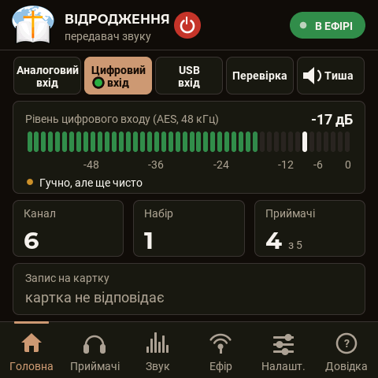 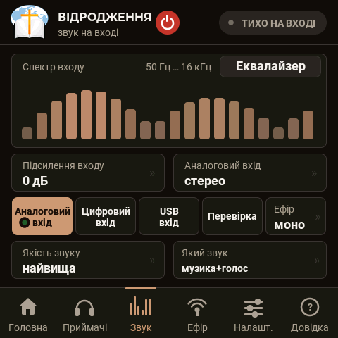

### Головна
- **Аналоговий вхід · Цифровий вхід · USB вхід · Перевірка · Тиша** (4.x) — що йде в ефір: лінійний вихід пульта
  через АЦП моста, цифровий вихід пульта (AES/EBU або S/PDIF), звук із комп'ютера через USB моста, перевірочний звук
  або тиша (пакети йдуть, звуку в них немає — приймачі не засинають). Вогник на кнопці — цей вхід зараз звучить.
  Якщо на обраному вході нічого немає (наприклад, кабель AES не вставлено), під кнопками з'являється пояснення.
- **Рівень входу** — у дБ, із позначкою піку та підказкою («Тихо», «Гучно, але ще чисто», «Перевантаження —
  зменшіть рівень на пульті»).
- Плитки **Канал**, **Набір**, **Приймачі** (скільки на зв'язку з усіх), **Запис на картку**.

### Звук
Спектр входу; **Підсилення входу** (−12…+24 дБ); **Аналоговий вхід** (4.x, див. нижче); ряд кнопок входів, як на
головній; **Ефір** моно/стерео; **Якість звуку**; **Який звук** у режимі перевірки (тон, голос, голос і музика,
музика, музика з оголошенням кожні N секунд, перевірка каналів ліво/право) з вибором мелодії та гучностей.

**Аналоговий вхід** (4.x) — як міст бере вхід PCM1808, чотири варіанти:
- **Стерео, гул радіо прибирати** (з коробки) — лівий і правий як є; гул 250 Гц від радіо самого передавача міст
  вивчає в паузах і віднімає (на приладі −81 → −108 дБ), музику не чіпає;
- **Симетричний, гул радіо прибирати** — моно з різниці каналів: для симетричного виходу пульта (XLR: 2 → лівий,
  3 → правий, 1 → земля); гул «землі» однаковий в обох проводах і віднімається;
- **Стерео як є / Симетричний як є** — те саме без віднімання гулу.

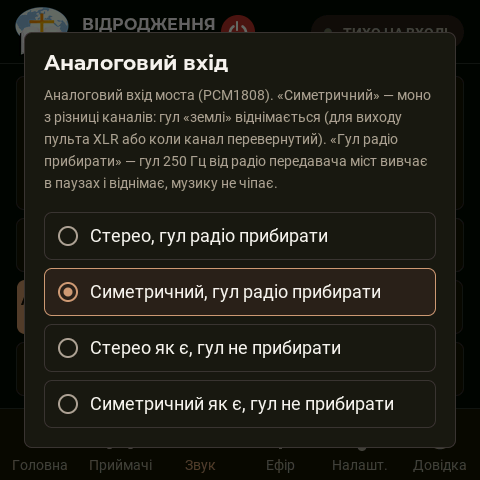 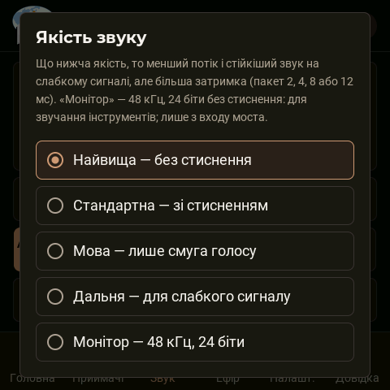

**Якість звуку**: найвища (без стиснення, кадр 2 мс), стандартна, мова, дальня — як раніше; **Монітор** (4.x) —
48 кГц, 24 біти без стиснення, для прослуховування звучання інструментів (лише зі входу моста; у кожному пакеті —
стиснена копія попереднього, тож один загублений пакет не дає дірки).

**Еквалайзер** (кнопка на плитці спектра, з 2.45) — еквалайзер входу: править звук із пульта один раз для всіх
приймачів. П'ять смуг (низ 125 Гц, 400 Гц, 1 кГц, 2,5 кГц, верх 6 кГц), кожна −12…+12 дБ кроком 2, і зріз низів
нижче 100 Гц. Діє на звук зі входу (вбудованого чи PCM1808); перевірочного звуку й файлів із картки не чіпає.
Спектр на цій сторінці показує звук уже після еквалайзера.

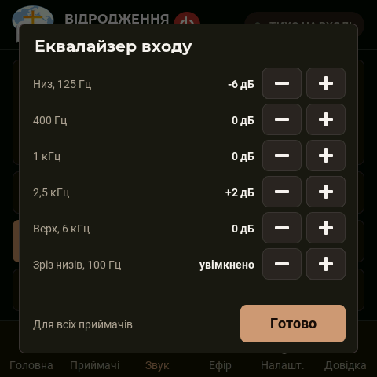

**Шум входу** (з 2.71; у вікні еквалайзера — кнопка **Шумозаглушення**, назад — **Еквалайзер**) прибирає рівний шум
(шипіння, гул) зі звуку пульта ще до ефіру: **Шумозаглушення** вимкнено / слабке / середнє / сильне; **Чутливість до
шуму** від дуже низької до дуже високої (вище — шум прибирається повніше, але тихі закінчення слів глухіші); **Зразок
шуму** — «сам, у паузах» або «запам'ятати зараз» (кілька секунд у пульт має йти лише тиша з шумом). Діє на звук зі
входу; перевірочного звуку й файлів із картки не чіпає.

**Шумовий поріг** (з 3.17, там само, на листі «Шум входу»; власник: «имеется ровный фоновый шум в виде шипения с
передатчика… при проверочном звуке шипение полностью отсутствует, а значит причина точно в adc») — у паузах, коли звук
із пульта не голосніший за шум входу, передавач приглушує його: **Шумовий поріг** вимкнено / у паузах −12 / −20 /
−30 дБ / тиша в паузах (у ефір іде рівно нуль); **Поріг над шумом** — +3…+15 дБ: звук, тихіший за шум входу плюс це
число, вважається паузою (шум входу передавач міряє сам); **Закриття порогу** — швидко / середньо / повільно: після
звуку поріг 60 / 150 / 300 мс тримається відкритим (закінчення слів) і гасить шум за 60 / 150 / 400 мс. Відкривається
поріг за 2 мс, тож початок слова не губиться. Унизу листа — **шум входу й поріг зараз** (зелене — поріг закрив паузу).
Шумозаглушення прибирає шипіння й під голосом; поріг — лише в паузах, зате до повної тиші: їх можна вмикати разом.

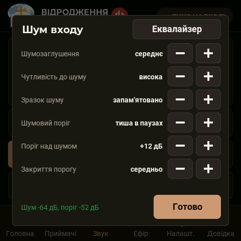

**Піки входу** (з 3.24, третій лист того ж вікна: кнопка вгорі праворуч гортає «Еквалайзер → Шумозаглушення → Піки
входу») — обмежувач піків звуку з пульта (з 3.18; власник: «при перегрузах на входе начинается треск на выходе. Нужно,
чтобы передатчик выполнял компрессию звука в таких пиках»). Стоїть після еквалайзера й підсилення входу і заздалегідь
(за 1,5 мс) прибирає підсилення рівно настільки, щоб пік не вийшов за стелю, — без зрізу й тріску. **Обмежувач піків**
увімкнено / вимкнено (з коробки — увімкнено); **Стеля** −0,5 / −1 / −2 / −3 дБ від повної шкали; **Стискання піків** —
немає / легке / середнє / сильне: нижче стелі гучні місця м'яко стискаються (легке — від −6 дБ 2:1, середнє — від
−10 дБ 3:1, сильне — від −14 дБ 4:1); **Відпускання** — швидко / середньо / повільно (40 / 120 / 300 мс);
**Підсилення входу** — те саме, що на вкладці «Звук» (−12…+24 дБ кроком 3), — тут поряд з обмежувачем, бо їх
виставляють разом. Унизу листа раз на секунду: зелене «Обмежувач знижує на N дБ» — працює; **червоне «АЦП зрізає: N —
тихіше пульт»** — у край шкали впирається вже сам АЦП: цього обмежувач не виправить, треба зменшити рівень на пульті
(або на вході АЦП — див. [Обладнання](hardware.md)); «Піки в межах шкали» — усе гаразд.

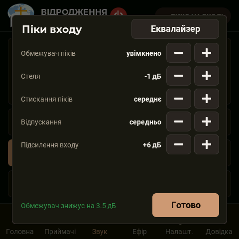

Чому звук із пульта тихіший за перевірочний: перевірочний звук іде повз еквалайзер входу, а пульт — крізь нього; зріз
низів і −10 дБ на 125 і 400 Гц прибирають з музики чи голосу до 10 дБ гучності. Тоді додають **Підсилення входу**: піки
тримає обмежувач, шипіння в паузах — шумовий поріг.

| Якість | В ефірі | Додає затримки | Найменша швидкість радіо | Коли брати |
|---|---|---|---|---|
| найвища | 32 кГц без стиснення; два кадри в пакеті, минулий пакет повторено без стиснення (з 2.77); у стерео з 2.86 і різниця каналів без стиснення — приймач грає ті самі Л і П, що на вході | 2 мс | 5,5 Мбіт/с | зал до ~15 м, чистий ефір, музика |
| стандартна | 32 кГц ADPCM; на 1 Мбіт/с — новий кодек «вісім смуг» (з 2.79) | 4 мс | 1 Мбіт/с | звичайний вибір |
| мова | 16 кГц ADPCM (до 7 кГц) | 8 мс | 1 Мбіт/с | проповідь, зайнятий ефір |
| дальня | 16 кГц ADPCM | 12 мс | 0,5 Мбіт/с | найбільша дальність, лише моно |

Якщо вибрана якість «не вміщується» в поточну швидкість радіо, в ефір іде найближча нижча — меню це показує
(«мова — за швидкістю»).

**Дальній режим (з 2.79).** Коли передавач заради слабкого приймача переходить на 1 Мбіт/с (див. «Ефір»), якість
«стандартна» йде новим кодеком: вісім смуг по 2 кГц, кадр 4 мс, у пакеті кадр і три запасні копії — три втрачені
пакети поспіль не дають провалу. На записі проповіді він чистіший за колишню «мову» (сигнал/шум «на слух приймача»
41,6 дБ проти 30,5) і навіть за «стандартну» ADPCM (39,2 дБ). Лише моно: стерео на цій сходинці йде моно.

### Ефір

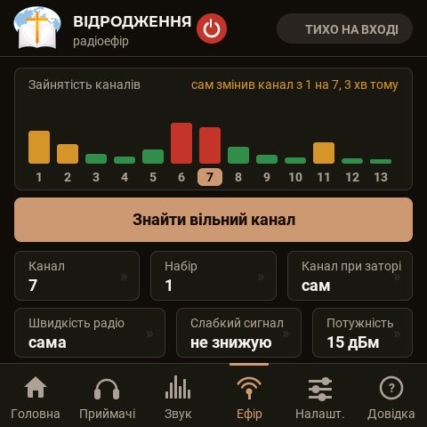

- **Зайнятість каналів** і кнопка **Знайти вільний канал** (звук перерветься на дві секунди). З 2.82 замір
  враховує сильні сусідні мережі: точка доступу поруч заважає своєю енергією і через кілька каналів (через три канали
  — ще заважає, через дев'ять — ні), тому такі канали на графіку вищі.
- Якщо на поточному каналі пакети часто чекають ефіру 15 мс і довше, угорі сторінки жовтий рядок **«канал N: пакети
  чекають ефіру до X мс»**: на стільки ж у приймачів запізнюється звук. Ліки — канал далі від сильних мереж.
- **Канал** 1–13; **Набір** — номер вашого набору (приймачі чують тільки свій).
- **Канал при заторі: сам** — коли пакети довго чекають ефіру, передавач сам переходить на вільніший канал без паузи
  (приймачам перехід оголошується заздалегідь, вони йдуть за ним). З 2.83 — і коли пакети просто часто чекають по
  15–35 мс (звук запізнюється): це **проба** — за хвилину на новому каналі передавач порівнює й повертається, якщо
  там чекання не менше або в приймачів частіше пропадає звук. З 2.88 проба починається й тоді, коли **приймач із
  добрим сигналом** (−62 дБм і сильніше) губить за хвилину 1,5 % пакетів і більше: це завади біля нього (чути
  клацання), передавач їх не чує й за своїм заміром каналів не бачить. Тоді передавач пробує найкращий за заміром з
  інших каналів і лишається там, якщо втрат стало хоча б на третину менше. Про перехід і причину — повідомлення на
  екрані. Канал, з якого пішли через затор, десять хвилин не вибирається; невдалий пробний — пів години.
- **Швидкість радіо**. «Сама»: 5,5 Мбіт/с, а заради слабкого приймача (−75 дБм і слабше або в нього пропадає звук) —
  1 Мбіт/с, де чути далі (з 2.73). Назад — коли всі чують добре: через 30 с, якщо найслабший −66 дБм і краще, через
  2 хв — якщо ближче до межі (з 2.83). Вибрана вручну швидкість — верхня сходинка: униз передавач сходить так само,
  у рядку тоді «5.5 (зараз 1)» і повідомлення, хто чує слабо.
- **Слабкий сигнал** (з 2.83): *знижую* / *не знижую*. «Не знижую» — швидкість і якість завжди такі, як обрано, але
  далекий приймач може втрачати звук. Якщо вибрати швидкість чи якість, поки передавач стоїть на 1 Мбіт/с через
  слабкий приймач, він піднімається одразу, коли приймачі вже чують, а коли ні — пише, хто чує слабо і де це вимкнути.
- **Потужність** 2–20 дБм.

### Приймачі

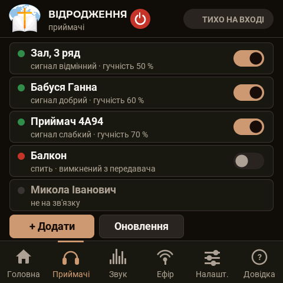 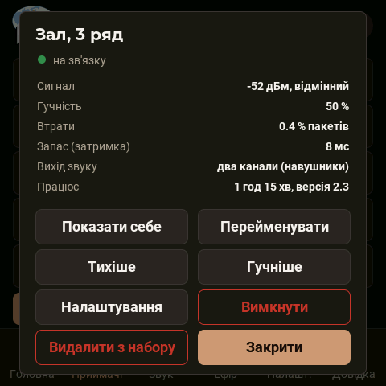

Рядок приймача: ім'я, сигнал, гучність; перемикач праворуч — вимкнути чи ввімкнути приймач дистанційно (вимкнений
засинає й будиться лише командою «увімкнути» з передавача: з версії 2.65 своєю ручкою приймач увімкнути не можна —
і після вимкнення живлення, і коли передавач не працює; передавач сам повертає приймач у заданий ним стан).
Дотик до рядка відкриває вікно приймача: сигнал, гучність, втрати, запас, вихід, час роботи й версія; кнопки
**Показати себе** (приймач блимає білим, на екрані «ЦЕ Я», у навушниках гудки), **Перейменувати** (до 32 літер),
**Тихіше / Гучніше**, **Налаштування**, **Вимкнути**, **Перезапустити** (приймачі з 2.84 — перезапуск по радіо, коли
звук пропав, а до кнопки не дістатися; звук повертається за 1–2 с), **Видалити з набору**.

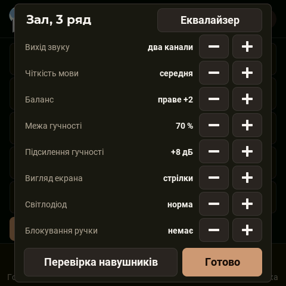 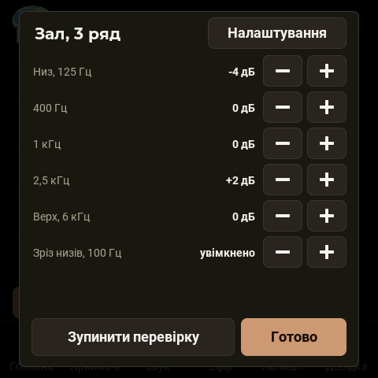

**Налаштування** приймача з передавача: вихід звуку, чіткість мови, баланс, межа гучності, **підсилення гучності**
(0…+24 дБ; у цьому списку з 2.63 — раніше стояло на аркуші еквалайзера), вигляд екрана, світлодіод, блокування ручки,
кнопка **Перевірка навушників**. Кнопка **Еквалайзер** праворуч від імені (приймачі з 2.45) відкриває другий аркуш
того самого вікна — еквалайзер цього приймача: ті самі п'ять смуг, зріз низів нижче 100 Гц (у приймача з коробки
ввімкнений) і мова написів приймача; назад — тією ж кнопкою («Налаштування»). Так звук підбирають під слух
конкретної людини, а еквалайзером входу — для всіх одразу.

Третій аркуш — **Обробка звуку** (приймачі з 2.68; та сама кнопка веде далі по колу): **Шумозаглушення** вимкнено /
слабке / середнє / сильне; **Чутливість до шуму**; **Зразок шуму** — «сам, у паузах» або «запам'ятати зараз»;
**Стискання** вимкнено / легке / середнє / сильне — тихе підсилюється, гучне притискається (разом із «Підсиленням»);
**У паузах** вимкнено / без підсилення / ще −6 дБ / ще −12 дБ — між словами приймач знімає підсилення, щоб не
підсилювати шум; **Поріг пауз** +3…+15 дБ над шумом; **Закриття пауз** швидко / середньо / повільно. Ті самі пункти —
у меню приймача.

Останній рядок — **Блокування ручки** (приймачі з 2.46): *немає* / *меню* (довге натискання меню не відкриває) /
*гучність* (поворот і «тиша» натисканням не діють) / *усе*. На приймачі при спробі з'являється «Заблоковано». З
передавача при цьому все міняється, як і раніше.

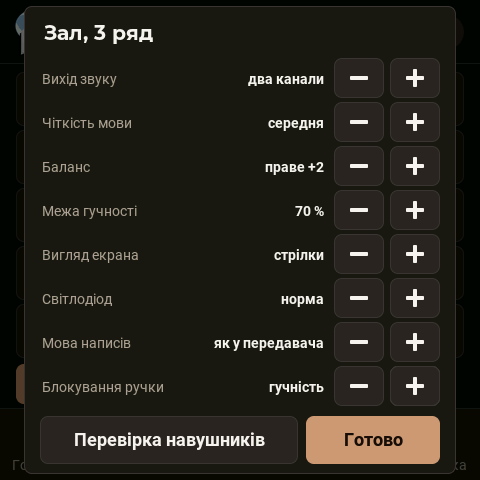

#### Додати приймач

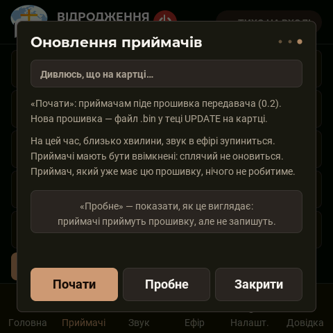

1. Увімкнути новий приймач поруч із передавачем. На його екрані «НЕ ПІДКЛЮЧЕНО», далі «прошу доступ» і **КОД** із
   чотирьох цифр.
2. На передавачі: «Приймачі» → **+ Додати**. Вікно відкрите три хвилини; у ньому з'являється запит із тим самим
   кодом.
3. Звірити код і натиснути **Дозволити**. Приймач отримує ключ набору й починає грати.

Приймач, який уже має ключ, чужих передавачів не слухає. Перевести його до іншого набору можна тільки на ньому
самому: меню → «Забути набір».

#### Видалити приймач
«Видалити з набору» — приймач втрачає доступ, ключ набору змінюється й сам розсилається решті приймачів (тим, що
були вимкнені, — коли ввімкнуться). Загублений приймач після цього нічого не почує.

### Оновлення прошивки

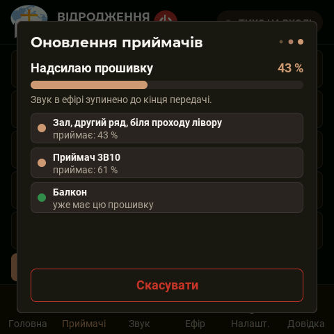 

**Через картку пам'яті (кабель не потрібен):**
1. Файл `hearlink-<версія>.bin` з [випусків](../../../releases/latest) покласти на картку (FAT32) у теку **`UPDATE`**
   у корені картки: `UPDATE/hearlink-2.34.bin`. Теку передавач створює сам. Ім'я файла може бути будь-яким,
   обов'язкове лише розширення `.bin`: версію передавач читає зсередини файла; з кількох файлів бере найновіший.
   Частини для заливання кабелем (`bootloader.bin`, `partitions.bin`, `boot_app0.bin`, `assets.bin`) сюди не класти.
2. Вставити картку — передавач знайде файл і відкриє вікно «Оновлення».
3. **Оновити**: спершу приймачам по радіо (близько 15 с передавання, звук в ефірі на цей час стоїть; запис у
   приймачі ще 15–30 с), потім передавач записує себе (близько хвилини, екран блимає — на ньому крупно
   «ОНОВЛЕННЯ ПРОШИВКИ — НЕ ВИМИКАЙТЕ ЖИВЛЕННЯ!!!») і перезапускається.

**Автоматично** (з 2.42): коли на зв'язок виходить приймач із прошивкою, старішою за прошивку передавача (був
вимкнений чи спав під час оновлення або щойно доданий), передавач приблизно за 10 с сам починає роздачу. Звук в
ефірі зупиняється на ~20 с для всіх; не більше двох спроб на приймач за одне ввімкнення передавача. Вимкнути /
увімкнути: кнопка **«Автооновлення: увімкнено / вимкнено»** у вікні «Оновлення» (з 2.46) або команди порту `M7` / `M6`.
З 2.56 екран передавача про це каже сам: вікно «Оновлення» з ходом відкривається без дотику й закривається через
15 с після кінця (підсумок — повідомленням); якщо в цю мить відкрите інше вікно — замість нього коротке повідомлення.

**Кабелем із комп'ютера** (сценарій `build.sh`): поки комп'ютер записує прошивку, процесор передавача стоїть у
завантажувачі й малювати не може — екран близько хвилини чорний. Тому перед записом (з 2.50) на екрані з'являється
попередження «ОНОВЛЕННЯ ПРОШИВКИ — ЕКРАН ЗГАСНЕ НА ХВИЛИНУ — НЕ ВИМИКАЙТЕ ЖИВЛЕННЯ!!!», а після першого запуску з
новою версією — «Передавач оновлено: версія …». Якщо потрібен хід оновлення на екрані — оновлюйте через картку.

**Тільки приймачі** (передавач уже нової версії): «Приймачі» → «Оновлення» → **Почати**.
**Пробне** — показати, як це виглядає: приймачі все приймають і звіряють, але нічого не записують.

Приймач, що спить, не оновиться — оновіть його іншим разом. Обірване оновлення нічого не псує: поки нову прошивку
не записано й не перевірено цілком, приймач запускається зі старої.

### Картка пам'яті

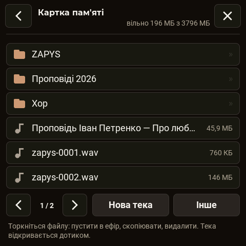 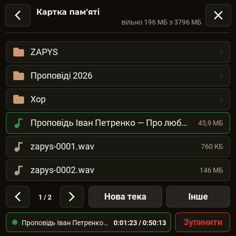

- **Запис ефіру** — плитка «Запис на картку» на головній: WAV 32 кГц моно 16 біт, близько 230 МБ на годину, тека
  `ZAPYS`. Заголовок файлу оновлюється кожні п'ять секунд — при раптовому вимкненні пропаде не більше.
- **Файли** — файловий менеджер: теки, перегляд текстових файлів, копіювання, видалення, нова тека, форматування.
- **Файл в ефір** — дотик до файла MP3 або WAV → «В ефір»: файл грає замість входу (фонова музика до служби).
- **Плеєр** (з 3.28; власник: «при воспроизведении из карты памяти должен открываться плеер с полосой воспроизведения
  для быстрой перемотки и перехода на нужную часть трека, отображение как в audacity») — відкривається сам, щойно файл
  пішов в ефір, і дотиком до смужки «в ефірі» внизу списку. Увесь трек — однією хвилею, як в Audacity: зігране —
  золотим, решта — сірим, біла риска з трикутником — де звук зараз. **Торкніться хвилі або протягніть пальцем** —
  головка йде за пальцем, час підписано; відпустили — файл грає з цього місця (звук плавно йде і плавно входить, близько
  пів секунди тиші). Кнопки: **-10 с**, **Пауза / Грати** (у паузі в ефірі тиша, місце в треку тримається), **Стоп**,
  **+10 с**; стрілка «назад» — до списку, файл грає далі. Хвиля будується у фоні зліва направо («Будую хвилю… N %»;
  для довгого MP3 — до хвилини-двох, на повільній картці довше); перейти можна й раніше. MP3 передавач цілком не
  розбирає — висоту стовпця оцінює за службовою частиною кадрів (форма та сама, що в справжньої хвилі, хоча гострі піки
  можуть бути менш точні), зате місце кожного кадру відоме — перехід за часом точний і для MP3 зі змінним потоком.

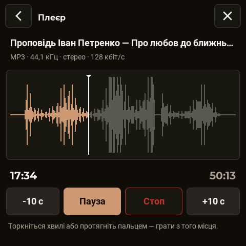
- Тека `LOG` — журнал «чорної скриньки» радіо; тека `UPDATE` — оновлення.

### Налаштування
Яскравість екрана, гасіння екрана (ніколи / 1 / 5 / 15 хв), назва джерела звуку (напис на кнопці замість
«З пульта»), мова (Українська / English — приймачі беруть її самі), «Про пристрій», «Налагодження ефіром»,
**Перезапустити**, **Скинути все**.

Кнопка вимкнення у шапці: ефір замовкає, екран гасне; вмикає дотик до екрана. Приймачі за 10 с без сигналу
засинають самі.

## Приймач

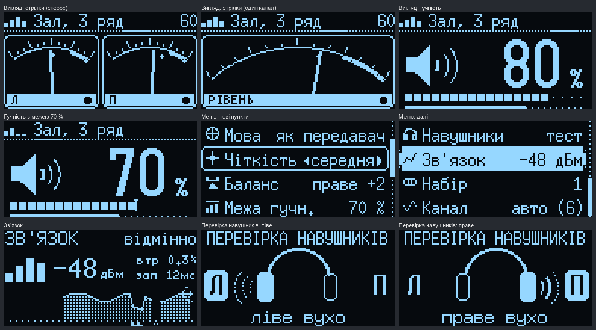

### Ручка
| Дія | На головному екрані | У меню |
|---|---|---|
| поворот | гучність 0…100 % (крок 5 %) | вибір пункту / зміна значення |
| натискання | тиша / звук | увійти в пункт / підтвердити |
| довге натискання (0,7 с) | меню | назад |
| будь-який рух, коли екран погашено | увімкнути екран | — |
| будь-що без сигналу (пошук, «НЕМАЄ СИГНАЛУ», сон) або коли вимкнений з передавача | нічого: ручка не діє зовсім — ні гучність, ні «тиша», ні меню (з 3.14; приймач сам прокидається, коли чує передавач) | — |

### Що він показує

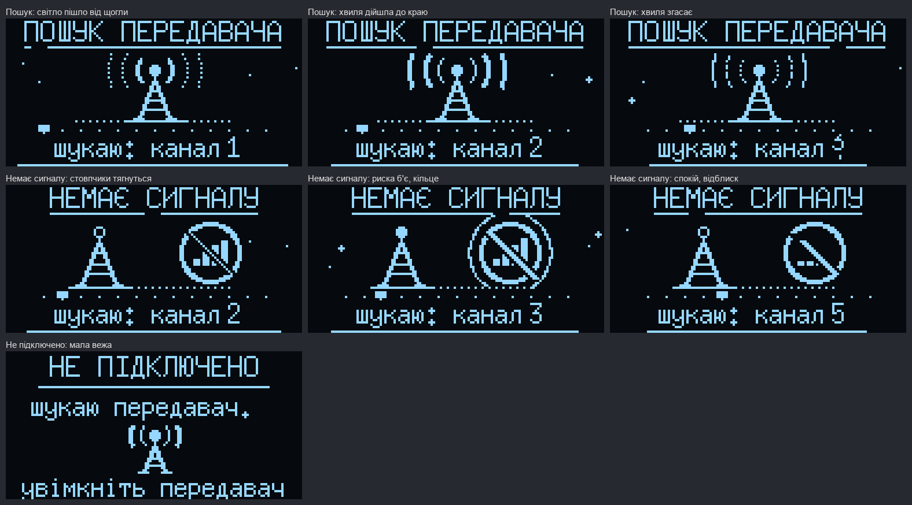

| Екран | Коли |
|---|---|
| заставка (4 с) | увімкнення, пробудження |
| «ПОШУК ПЕРЕДАВАЧА» — вежа з хвилями, шкала каналів | шукає 10 с, потім засинає |
| «ЗАПУСК» — смужка 4 с | передавач знайдено; звук входить через 1,5 с, плавно |
| головний екран | робота |
| «НЕМАЄ СИГНАЛУ» — вежа без хвиль і перекреслений знак | сигнал зник; за 10 с — сон |
| «ТИША» | натиснули ручку |
| «НЕ ПІДКЛЮЧЕНО» + код | приймач ще не в наборі |
| «ОНОВЛЕННЯ» з ходом | іде оновлення по радіо |
| «ЦЕ Я» | з передавача натиснули «Показати себе» |

Угорі головного екрана — рівень сигналу (чотири стовпчики), ім'я, гучність. Зверху виїжджають сповіщення:
«Сигнал відновлено», «Слабкий сигнал», «Гучно на вході!», «Тиша в ефірі», «Межа гучності», «Чіткість: середня»
(налаштування змінили з передавача) тощо.

### Кольоровий екран (з 3.03)

Замість OLED приймач може мати кольоровий екран IPS 1,9″ (як під'єднати й вибрати — у розділі
[Обладнання](hardware.md#кольоровий-екран-ips-19-на-приймачі-з-прошивки-303)). Екрани ті самі, що на OLED, лише
більші й кольорові.

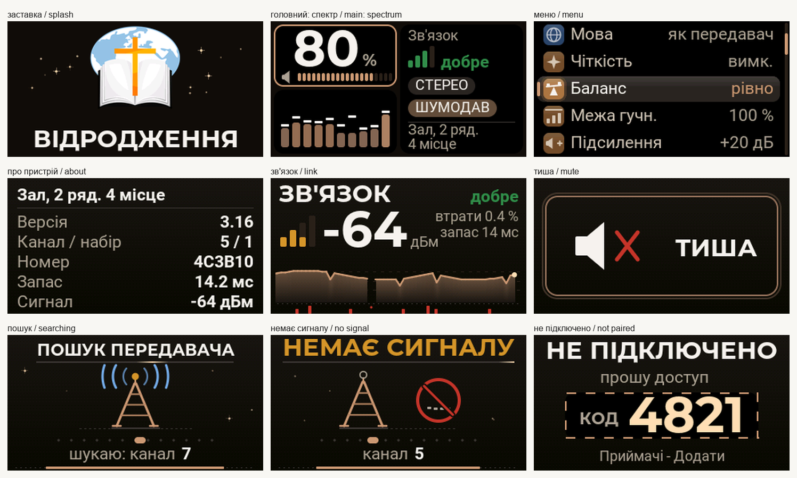

Головний екран (вигляд «спектр», з 3.08 — за розкладкою власника):

- **ліворуч угорі — гучність** великими цифрами й двадцять поділок; поки крутять ручку, число «перегортається» до
  нового значення, а рамка картки підсвічена;
- **ліворуч унизу — аналізатор спектра:** 10 стовпчиків, над кожним — біла позначка піку, що тримається 0,45 с і
  плавно опускається; коли передавач вимкнув звук в ефірі — «ТИША В ЕФІРІ». Колір стовпчика — за висотою (з 3.23,
  плавними відтінками з 3.25; власник: «до 1/3 высоты — зеленый… выше 1/3 стремится к желтоватому, а при максимуме уже
  ярко красный», «градация цветов… плавно оттенками»): кожен рядок точок має свій відтінок — до третини висоти зелений,
  до двох третин плавно переходить у жовтий, угорі — у яскраво-червоний. Невисокий стовпчик зелений, середній — із
  жовтуватою верхівкою, повний — із червоним кінчиком;
- **праворуч — «Зв'язок»** (стовпчики й слово: немає / слабо / помірно / добре / відмінно), плашки «СТЕРЕО» або
  «МОНО» і «ШУМОДАВ» (коли шумозаглушення ввімкнене), під рискою — ім'я приймача в один-два рядки.

Інші вигляди («стрілки», «гучність»), меню, «Про пристрій», «Зв'язок», «ТИША», пошук, «НЕМАЄ СИГНАЛУ», оновлення й
сон — як на OLED, у кольорі. На екран іде лише те, що змінилося, тож усе рухається плавно (60 кадрів за секунду).
Усі написи — білі (з 3.23 — ім'я, «Зв'язок», «%», з 3.27 — усе меню й підписи; власник: «на данном дисплее из-за не
качественного черного цвета подобные цвета как сейчас сливаются»); кольоровими лишились слова стану («добре», «слабо»).

### Меню
| Пункт | Значення |
|---|---|
| **Вигляд** | спектр / стрілки / гучність (велика цифра) |
| **Світлодіод** | вимк. / тьмяно / норма / яскраво |
| **Мова** | як передавач / українська / English |
| **Чіткість** | вимк. / легка (+4 дБ) / середня (+8) / сильна (+12) — підйом вище 2 кГц, де приголосні |
| **Баланс** | ліве +1…+5 / рівно / праве +1…+5 (по 3 дБ); лише при виході «2 канали» |
| **Підсилення** | вимк. / +2…+24 дБ — цифрове підсилення понад «звук як є», як «trim» на пульті: на скільки виставлено, на стільки звук і підсилюється (з 2.63; у 2.48–2.56 воно діяло лише в запас до повної шкали й на гучній музиці майже не відчувалось). Якщо підсилений звук не вміщується в шкалу ЦАП — гучне джерело на великій гучності, — піки притримує обмежувач: тріску немає, але музика стає щільнішою. Гучніше за повну шкалу цифрою не зробити: запас понад неї дає лише підсилювач навушників |
| **Межа гучн.** | 20…100 % — стеля гучності: шкала на ручці лишається 0…100 %, але 100 % звучить як ця межа (з 2.41) |
| **Стискання** | вимк. / легке / середнє / сильне — тихе підсилюється, гучне притискається (з 2.68) |
| **У паузах** | вимк. / без підс. / ще −6 дБ / ще −12 дБ — у паузах мови підсилення знімається (з 2.68) |
| **Поріг пауз** | +3…+15 дБ над шумом — що вважати паузою (з 2.72) |
| **Закриття** | швидко / середньо / повільно — як швидко пауза «закривається» (з 2.72) |
| **Шумозагл.** | вимк. / слабке / середнє / сильне — спектральне шумозаглушення (з 2.68) |
| **Чутл. шуму** | 1…5 з 5 — вище: шум прибирається повніше, тихі закінчення слів глухіші (з 2.72) |
| **Зразок шуму** | сам (учиться в паузах) / взято (запам'ятати зараз: кілька секунд тиші з шумом) (з 2.72) |
| **Навушники → тест** | тон по черзі в ліве й праве вухо |
| **Зв'язок** | сигнал у дБм, втрати, запас, графік за хвилину |
| Набір | номер набору (тільки показ) |
| Канал | авто або 1–13 |
| Запас | «сам» або 4–40 мс — буфер проти нерівного ефіру (він же затримка) |
| Вихід звуку | PDM / PCM5102 / CS4344 (перезапуск; CS4344 — з 2.85) |
| Виводи | 2 канали / протифаза |
| Екран | вимкнути (вмикає будь-який рух ручки) |
| Яскравість | 1…5 — підсвітка кольорового екрана або контраст OLED (з 3.03) |
| Забути набір | стерти ключ — приймач знову проситиме доступ |
| Перезапуск | «ТАК» і натискання — перезапуск приймача (з 2.84; коли звук пропав, а до кнопки не дістатися) |
| Про пристрій | версія, канал, набір, номер, запас, сигнал |

### Світлодіод
| Колір | Стан |
|---|---|
| не світиться | сон, вимкнений з передавача |
| блимає синім | запуск, пошук, сигнал зник |
| повільно «дихає» зеленим | працює, в ефірі тихо |
| «дихає» жовтим | працює, в ефірі звук |
| блимає червоним 6 с | передавача не знайдено, засинаю |
| «дихає» фіолетовим | оновлення прошивки |
| часто блимає білим | «Показати себе» (і при вимкненому світлодіоді) |

### Сон
10 с без сигналу → 6 с повідомлення → сон: екран, вихід звуку й радіо вимкнені, процесор спить. Раз на пів секунди
приймач на 0,07 с вмикає радіо й слухає свій канал (кожне четверте коло — решту каналів). Почув свій передавач —
прокидається сам: заставка, «ЗАПУСК», звук.

### Самовідновлення звуку (з 2.84)
Якщо звук пропав, хоча приймач на зв'язку й у ефірі звук (застрягла обробка звуку), приймач за 1,5 с сам скидає
обробку, а якщо не допомогло — перезапускається без заставки (не частіше разу на 10 хвилин). Про кожен такий випадок
передавач пише в порт і в журнал на картці. Вручну — «Перезапуск» у меню приймача або «Перезапустити» в його вікні на
передавачі.
